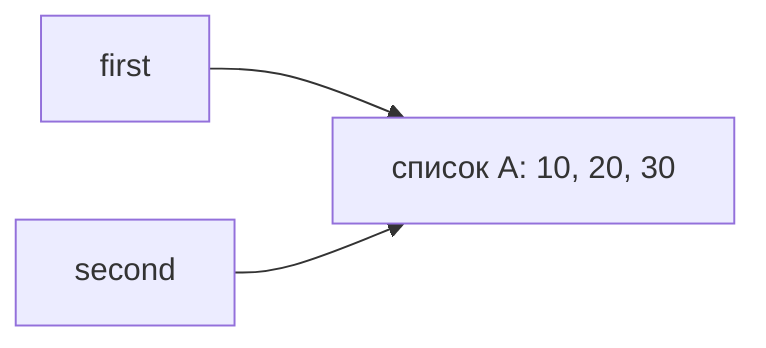
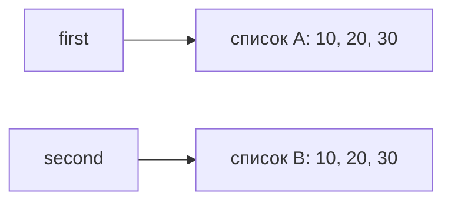
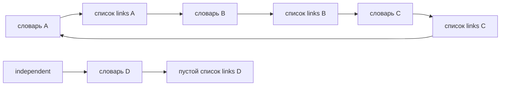

# Лабораторная 2 — объяснение с самого начала

Начнём с маленьких программ. Пока не нужно читать целиком файлы заданий: сначала разберём, что означают их основные действия. Примеры из разных шагов независимы. Внутри одного шага можно продолжать работать с уже созданными переменными.

Цель работы простая: научиться понимать, **что именно меняется при выполнении программы**, почему иногда изменение видно сразу в двух местах и почему одни данные занимают больше памяти, чем другие.

## Содержание

- [Начало с нуля](#начало-с-нуля)
- [Что означают обозначения в коде](#что-означают-обозначения-в-коде)
- [Задание 1 — имена и объекты](#задание-1--имена-и-объекты)
- [Задание 2 — копирование](#задание-2--копирование)
- [Задание 3 — сильные и слабые ссылки](#задание-3--сильные-и-слабые-ссылки)
- [Задание 4 — циклы и сборщик мусора](#задание-4--циклы-и-сборщик-мусора)
- [Задание 5 — измерение памяти](#задание-5--измерение-памяти)
- [Как рассказать работу на защите](#как-рассказать-работу-на-защите)
- [Проверка себя](#проверка-себя)
- [Что я должен понять после этой работы](#что-я-должен-понять-после-этой-работы)

## Начало с нуля

### Шаг 1 Переменная и вывод на экран

```python
age = 18
print(age)
```

Первая строка связывает имя `age` со значением 18. Вторая показывает это значение на экране:

```text
18
```

`age` — имя переменной. Вместо него можно было написать другое подходящее имя. `print()` — готовая функция Python для вывода. Круглые скобки содержат то, что нужно вывести.

В Python строки выполняются по порядку. Например:

```python
age = 18
age = 19
print(age)
```

Теперь результат — 19: мы заново связали имя `age` с другим значением. Это называется **переназначением**.

Текст пишется в кавычках: `name = 'Лев'`. Число 18 и текст `'18'` — разные виды данных, хотя при обычном выводе могут выглядеть похоже.

### Шаг 2 Что такое список и элемент

Список позволяет собрать несколько значений вместе:

```python
marks = [5, 4, 3]
print(marks)
```

Квадратные скобки `[...]` создают список, запятые разделяют его **элементы**. Здесь три элемента: число 5, число 4 и число 3. На экране будет `[5, 4, 3]`.

Чтобы взять один элемент, после имени пишут его номер в квадратных скобках:

```python
marks = [5, 4, 3]
print(marks[0])
print(marks[1])
print(marks[2])
```

Результат по строкам: 5, 4, 3. **Нумерация начинается с нуля:** `[0]` — первый элемент, `[1]` — второй, `[2]` — третий. Номер элемента называется индексом.

`len(marks)` вернёт 3 — количество элементов списка.

### Шаг 3 Как изменить список

```python
marks = [5, 4]
marks.append(3)
print(marks)
```

`append(3)` добавляет число 3 в конец уже существующего списка. Результат — `[5, 4, 3]`.

Можно заменить конкретный элемент:

```python
marks = [5, 4]
marks[0] = 2
print(marks)
```

Получится `[2, 4]`. Здесь изменили содержимое списка. Новый список вместо него не создавали.

Сравни две записи:

- `marks[0] = 2` — заменить первый элемент существующего списка.
- `marks = [2, 4]` — создать список и связать с ним имя `marks`.

По напечатанным элементам результат может выглядеть одинаково. Но для этой лабораторной важно, менялся ли старый список или имя стало указывать на другой.

### Шаг 4 Почему два имени могут показывать один список

```python
a = [5, 4]
b = a
b.append(3)
print(a)
print(b)
```

Обе строки вывода — `[5, 4, 3]`.

Причина: `b = a` **не создаёт копию списка**. Список один, просто обратиться к нему можно через два имени.

```text
a ──┐
    ├──> один список [5, 4, 3]
b ──┘
```

Здесь вводятся три термина, которые будут встречаться дальше:

- **Имя** — `a` или `b`.
- **Объект** — сами данные, например этот список. Число и строка тоже объекты Python.
- **Ссылка** — связь, через которую имя или другой объект позволяет обратиться к объекту.

Теперь сравни с отдельным примером:

```python
a = [5, 4]
b = [5, 4]
b.append(3)
print(a)
print(b)
```

Результат: `a` — `[5, 4]`, `b` — `[5, 4, 3]`. Здесь выражение `[5, 4]` выполнено два раза, поэтому созданы два отдельных списка.

### Шаг 5 Что значит изменяемый и неизменяемый

Список называют **изменяемым**, потому что можно менять его элементы, добавлять новые и удалять старые, сохраняя тот же объект списка.

Целое число называют **неизменяемым**. Посмотри:

```python
a = 10
b = a
a = a + 1
print(a)
print(b)
```

Результат: 11 и 10. Вычислилось число 11, имя `a` стало связано с результатом, а имя `b` осталось связано с 10. Сам объект числа 10 никто не переделывал в 11.

В таком примере `a += 1` — сокращённая запись увеличения числа. Но для разных типов объектов поведение `+=` может различаться, поэтому нельзя считать, что любая операция с любым объектом обязательно создаёт новый объект.

**Неизменяемое число не означает неизменяемую переменную:** имя можно переназначить, как в примере выше.

### Шаг 6 Что такое список внутри списка

В списке могут лежать не только числа, но и другие списки. Например, сохраним предметы с оценками:

```python
subjects = [
    ['Python', 5],
    ['Algorithms', 4],
]
```

Здесь:

- **Внешний список** — весь `subjects`. В нём два элемента.
- **Первый вложенный список** — `['Python', 5]`.
- **Второй вложенный список** — `['Algorithms', 4]`.

«Внутренний» или «вложенный» — значит просто «находящийся внутри другого списка». Никакого особого нового типа списка здесь нет.

```text
subjects — внешний список
    первый элемент  -> ['Python', 5]      — вложенный список
    второй элемент  -> ['Algorithms', 4]  — вложенный список
```

Разберём обращение к оценке:

```python
print(subjects[0])
print(subjects[0][1])
```

Первый вывод — `['Python', 5]`: взяли первый элемент внешнего списка. Второй вывод — 5: из полученного вложенного списка взяли второй элемент.

Следовательно, `subjects[0][1] = 3` означает: «В первом предмете замени оценку на 3».

Не путай два уровня изменения:

- `subjects.append(['Databases', 5])` — добавить предмет во внешний список.
- `subjects[0][1] = 3` — изменить оценку внутри уже существующего предмета.

### Шаг 7 Зачем бывают разные копии

Сначала возьмём список без вложенных списков:

```python
a = [5, 4]
b = a.copy()
b.append(3)
print(a)
print(b)
```

`copy()` создаёт другой внешний список. Поэтому `a` останется `[5, 4]`, а `b` станет `[5, 4, 3]`.

Теперь отдельный пример со списком внутри списка:

```python
a = [['Python', 5]]
b = a.copy()
b[0][1] = 3
print(a)
print(b)
```

Оба покажут `[['Python', 3]]`. У `a` и `b` внешние списки разные, но первый вложенный список **общий**. Обычный `copy()` скопировал внешний список, сохранив ссылки на его элементы. Это и называют **поверхностной копией**.

Если нужно независимо менять и вложенные списки, для этого примера подойдёт другая функция:

```python
from copy import deepcopy

a = [['Python', 5]]
b = deepcopy(a)
b[0][1] = 3
print(a)
print(b)
```

Первая строка подключает готовую функцию `deepcopy` из модуля `copy` стандартной библиотеки Python. Она здесь создаёт и отдельный внешний список, и отдельный вложенный список. Результат: `a` — `[['Python', 5]]`, `b` — `[['Python', 3]]`.

Это **глубокая копия**. Слово «глубокая» означает, что копирование затрагивает вложенные уровни структуры. Для начала достаточно понимать этот конкретный пример; ограничения такого копирования будут разобраны в задании 2.

| Запись | Что происходит в этих примерах |
|---|---|
| `b = a` | Ещё одно имя для того же списка |
| `b = a.copy()` | Другой внешний список, вложенные списки общие |
| `b = deepcopy(a)` | Другой внешний список и отдельные вложенные списки |

### Шаг 8 Что такое словарь в конфигурации проекта

Список позволяет находить значения по номеру, а **словарь** — по ключу. Например:

```python
project = {
    'name': 'Учебный проект',
    'members': ['Лев', 'Анна'],
}
print(project['name'])
print(project['members'])
```

Фигурные скобки `{...}` здесь создают словарь. Запись `'name': 'Учебный проект'` означает: ключ `'name'` связан со значением `'Учебный проект'`. На экране будут название и список участников.

В `project['members'].append('Иван')` сначала берётся список по ключу `'members'`, затем в этот список добавляется участник. В словаре тоже могут находиться изменяемые объекты. Поэтому вопрос о независимости копий важен и для него.

### Проверь, готов ли ты переходить к заданиям

Ответь себе на четыре вопроса:

1. Что означает `a[0]` для `a = [5, 4]`? — Первый элемент, то есть 5.
2. Создаёт ли `b = a` ещё один список? — Нет, появляется второе имя для того же списка.
3. Что такое внешний список в `a = [[1], [2]]`? — Сам `a`; его элементы — два вложенных списка `[1]` и `[2]`.
4. Почему `.copy()` может не защитить от изменения вложенной оценки? — Вложенный список остаётся общим.

Если эти ответы пока не понятны, вернись к соответствующему шагу. Остальная лабораторная строится на этих примерах.

## Что означают обозначения в коде

Эту таблицу можно использовать как справку по мере чтения, а не учить всю заранее.

| Запись | Что означает |
|---|---|
| `=` | Связать имя с результатом или заменить элемент контейнера — зависит от левой части записи |
| `==` | Сравнить значения; результат `True` означает «да», `False` — «нет» |
| `is` | Проверить, что это именно один объект, а не два равных по значениям |
| `is not` | Проверить, что объекты разные |
| `id(a)` | Получить идентификатор объекта; дальше сравниваются идентификаторы живущих одновременно объектов |
| `print(...)` | Показать значения на экране |
| `len(...)` | Получить число элементов |
| `# текст` | Комментарий для читателя |
| `"""текст"""` в начале файла | Краткое описание файла |
| `import sys` | Подключить модуль; его функцию вызывают, например, как `sys.getsizeof(...)` |
| `def name(...):` | Описать функцию; её действия выполнятся при вызове `name(...)` |
| `return value` | Вернуть результат из функции |
| `assert condition` | Проверить условие и остановиться с ошибкой, если оно ложно |
| `x and y` | Должны выполняться оба условия |
| `x or y` | Достаточно хотя бы одного из условий |
| `\n` внутри строки | Перевод строки при выводе |

`assert b == 10` проверяет, что `b` равно 10. Если проверка прошла, она ничего не печатает. В этой работе `assert` подтверждает результаты опытов. При запуске с параметром `-O` проверки могут быть отключены; обычный запуск — `python task_1.py`.

Строки с одинаковым отступом относятся к одному блоку. Например, действия внутри функции или цикла имеют отступ: это часть синтаксиса Python.

### Что вообще требуется сделать в этой лабораторной

Работа состоит из пяти опытов, а не из одной большой программы:

1. Проследить, что происходит с двумя именами одного числа или списка.
2. Сравнить способы копирования и объяснить ошибку со строками матрицы.
3. Посмотреть, какие ссылки удерживают объект в памяти.
4. Создать объекты, которые ссылаются друг на друга, и показать их удаление после потери доступа к ним.
5. Сравнить способы хранения чисел по расходу памяти.

Для каждого опыта нужно назвать прогноз, выполнить действия и объяснить результат. Ниже сначала идут объяснения, затем полный код соответствующего задания. Для задания 5 приведены оба его файла. Поэтому можно читать по порядку без переключения между файлами.

## Задание 1 — имена и объекты

### Сначала маленький пример

Если два имени указывают на один список, добавление элемента через одно имя видно через другое. Если одно имя переназначить на новый список, связь разделится. В этом задании сравнивается такое поведение списка с поведением целого числа.

### Часть A — почему `b` осталось равно 10

1. `a = 10` связывает имя `a` с числом 10.
2. `b = a` связывает `b` с тем же объектом: сначала `a is b` истинно.
3. `a += 1` вычисляет результат 11 и связывает с ним имя `a`.
4. Связь имени `b` никто не менял: оно по-прежнему указывает на 10.

Целые числа **неизменяемы**: нельзя превратить сам объект 10 в объект 11. При этом переменную `a` переназначать можно. Неизменяемость относится к объекту, а не к имени.

Ожидаемый результат: сначала `10 10` и одинаковые идентификаторы; затем `11 10` и разные идентификаторы. Сами длинные числа `id()` запоминать не нужно.

### Часть B — почему список поменялся через оба имени

`second = first` создаёт ещё одно имя для того же списка. `append(30)` меняет этот список на месте и не создаёт вместо него новый список.



Далее `second = [10, 20, 30]` создаёт новый список и переназначает только `second`.



После переназначения `first == second` даёт `True`: элементы равны. Но `first is second` даёт `False`: списки разные. Поэтому после `second.append(40)` получаем:

```text
first:  [10, 20, 30]
second: [10, 20, 30, 40]
```

`id()` идентифицирует объект во время его жизни. Если объекты существуют одновременно и `id()` одинаковы, это один объект. После удаления объекта его идентификатор со временем может использоваться снова, поэтому сравнивать старый сохранённый `id` с любым будущим объектом нельзя.

### Практическая часть — конфигурации проекта

`project` — словарь. В нём ключ `'name'` связан со строкой, `'members'` — со списком участников, `'parameters'` — со списком вложенных списков.

Разберём выражение `project['parameters'][1][1]` по шагам:

```text
project['parameters']       -> [['mode', 'debug'], ['workers', 1]]
project['parameters'][1]    -> ['workers', 1]
project['parameters'][1][1] -> 1
```

После `alias = project` это один словарь с двумя именами. Поэтому добавление Анны и установка режима `release` через `alias` видны и через `project`.

`independent = deepcopy(project)` создаёт независимую копию словаря и нужных вложенных изменяемых объектов. Она создаётся **после** добавления Анны и смены режима, поэтому эти значения уже входят в копию. Далее в копию добавляется Иван и меняется число исполнителей. В исходной конфигурации этих изменений нет.

Проверки `is not` подтверждают, что словари и вложенные списки разные. Последние проверки значений подтверждают, что исходные участники и число исполнителей сохранились.

### Короткий ответ для защиты

> Присваивание не копирует объект, а связывает с ним имя. Изменение общего списка видно через оба имени. Целое число изменить на месте нельзя, поэтому после `a += 1` имя `a` связано с результатом 11, а `b` остаётся связано с 10.

**Типичный вопрос:** «Меняет ли `second = first` сам список?» Ответ: нет, меняется связь имени `second`; содержимое списка эта инструкция не трогает.

### Полный код `task_1.py`

```python
"""Задание 1. Имена, ссылки и изменяемость."""
from copy import deepcopy


print('A. Прогноз: сначала id равны; после a += 1 получим 11 и 10.')
# Число нельзя изменить на месте.
a = 10
b = a
print('До:', a, b, 'id:', id(a), id(b))
a += 1
print('После:', a, b, 'id:', id(a), id(b))
assert a == 11 and b == 10 and a is not b

print('\nB. Прогноз: append изменит общий список; переназначение разделит списки.')
first = [10, 20]
# Здесь оба имени указывают на один список.
second = first
print('До append:', first, second, 'id:', id(first), id(second))
second.append(30)
print('После append:', first, second, 'id:', id(first), id(second))
assert first is second and first == [10, 20, 30]
second = [10, 20, 30]
print('После переназначения:', first, second, 'id:', id(first), id(second))
print('==:', first == second, 'is:', first is second)
assert first == second and first is not second
second.append(40)
print('После изменения нового списка:', first, second)
assert first == [10, 20, 30] and second == [10, 20, 30, 40]

print('\nКонфигурации. Прогноз: присваивание оставляет объекты общими, deepcopy изолирует изменения.')
project = {'name': 'Учебный проект', 'members': ['Лев'],
           'parameters': [['mode', 'debug'], ['workers', 1]]}
alias = project
print('project до:', project)
print('alias до:', alias)
alias['members'].append('Анна')
alias['parameters'][0][1] = 'release'
print('project после:', project)
print('alias после:', alias)
assert alias is project
# Копируем и словарь, и вложенные списки.
independent = deepcopy(project)
print('project до:', project)
print('independent до:', independent)
independent['name'] = 'Второй проект'
independent['members'].append('Иван')
independent['parameters'][1][1] = 4
print('project после:', project)
print('independent после:', independent)
assert independent is not project
assert independent['members'] is not project['members']
assert independent['parameters'] is not project['parameters']
assert independent['parameters'][0] is not project['parameters'][0]
assert independent['parameters'][1] is not project['parameters'][1]
assert project['members'] == ['Лев', 'Анна']
assert project['parameters'][1][1] == 1
print('Итог: alias и project общие; изменяемые объекты independent независимы.')
```

## Задание 2 — копирование

### Что здесь сравнивается

У вложенного списка есть два уровня: внешний список предметов и отдельные строки с предметом и оценкой. Можно скопировать только первый уровень или также вложенные изменяемые объекты.

### Зачем нужна `show_lists()`

Функция только печатает текущее состояние списков и их идентификаторы. Запись `def show_lists():` сохраняет описание действий; выполнение происходит при вызове `show_lists()`.

Она читает имена `original`, `alias`, `shallow`, `deep` из уровня файла. К моменту первого вызова эти имена уже созданы. Если вызвать функцию раньше создания списков, возникнет `NameError`. Проверять нужно порядок вызова, а не только место определения функции.

### Три способа получить второй список

| Строка | Внешний список | Вложенные списки |
|---|---|---|
| `alias = original` | Тот же | Те же |
| `shallow = original.copy()` | Новый | Общие с исходным |
| `deep = copy.deepcopy(original)` | Новый | Отдельные в этом примере |

После `original.append(['Databases', 5])` меняется **внешний** список. Поэтому новый предмет появляется только у `original` и `alias`.

После `original[0][1] = 3` меняется **первый вложенный список**. Он общий у `original`, `alias`, `shallow`, поэтому все три показывают оценку 3. В `deep` остаётся оценка 5.

| Этап | `original` | `alias` | `shallow` | `deep` |
|---|---|---|---|---|
| После `append` | 3 предмета | 3 предмета | 2 предмета | 2 предмета |
| После замены оценки | Python: 3 | Python: 3 | Python: 3 | Python: 5 |

`original[0][1] = 3` заменяет ссылку на оценку внутри строки. Сам объект числа 5 при этом не превращается в 3. До изменения неизменяемое число 5 может быть общим даже с глубокой копией — для независимости списков создавать отдельные копии каждого целого числа не требуется.

### Почему ошибочная матрица меняется сразу в трёх строках

`[0] * 3` создаёт строку `[0, 0, 0]`. Внешнее умножение в `[[0] * 3] * 3` повторяет ссылку на эту строку три раза. Поэтому `wrong_matrix[0] is wrong_matrix[1]` истинно.

После `wrong_matrix[0][0] = 1` меняется один объект строки, который виден в трёх местах:

```text
[[1, 0, 0], [1, 0, 0], [1, 0, 0]]
```

В `[[0] * 3 for _ in range(3)]` выражение `[0] * 3` выполняется заново три раза. Получаются отдельные строки, поэтому изменится только первая. `_` — обычное имя переменной цикла; так показывают, что её значение здесь не нужно. Цикл `for row in ...` ниже просто выводит `id()` каждой строки.

### Когда какой способ выбирать

Если нужно независимое добавление предметов, но вложенные строки меняться не будут, достаточно поверхностной копии. Если нужно независимо менять и оценки во вложенных строках, в этой структуре подходит глубокая копия.

`deepcopy()` не стоит применять автоматически: копирование большой структуры тратит время и память, может скопировать данные, которые должны быть общими; некоторые ресурсы, например открытые файлы, так копировать нельзя. Также глубокая копия может сохранить повторные ссылки внутри самой копии: она не обязана превращать каждое вхождение одного объекта в отдельный объект.

### Короткий ответ для защиты

> Поверхностная копия создаёт новый внешний контейнер, но сохраняет ссылки на вложенные объекты. Поэтому вложенное изменение видно и в исходном списке. Глубокая копия даёт отдельные вложенные списки в нашем примере. Ошибка матрицы тоже связана с повторением ссылок на один изменяемый объект.

### Полный код `task_2.py`

```python
"""Задание 2. Копирование списков."""
import copy


def show_lists():
    # Эта функция только показывает четыре списка и их id.
    print('original:', original)
    print('alias:', alias)
    print('shallow:', shallow)
    print('deep:', deep)
    print('id внешних списков:')
    print(id(original), id(alias), id(shallow), id(deep))
    print('id первых вложенных списков:')
    print(id(original[0]), id(alias[0]), id(shallow[0]), id(deep[0]))
    print('id первых оценок:')
    print(id(original[0][1]), id(alias[0][1]), id(shallow[0][1]), id(deep[0][1]))


print('Прогноз: append увидит alias; замену оценки увидят alias и shallow; deep не изменится.')
original = [['Python', 5], ['Algorithms', 4]]
alias = original
shallow = original.copy()
deep = copy.deepcopy(original)

print('До изменений:')
show_lists()

original.append(['Databases', 5])
print('После append:')
show_lists()
assert len(alias) == 3
assert len(shallow) == 2
assert len(deep) == 2

original[0][1] = 3
print('После изменения оценки:')
show_lists()
assert alias is original
assert shallow is not original
assert shallow[0] is original[0]
assert deep[0] is not original[0]
assert shallow[0][1] == 3
assert deep[0][1] == 5

print('Прогноз: в wrong_matrix изменятся три строки, в correct_matrix только первая.')
wrong_matrix = [[0] * 3] * 3
correct_matrix = [[0] * 3 for _ in range(3)]
print('До:', wrong_matrix, correct_matrix)
print('id строк wrong_matrix:')
for row in wrong_matrix:
    print(id(row))
print('id строк correct_matrix:')
for row in correct_matrix:
    print(id(row))
wrong_matrix[0][0] = 1
correct_matrix[0][0] = 1
print('После:', wrong_matrix, correct_matrix)
assert wrong_matrix == [[1, 0, 0], [1, 0, 0], [1, 0, 0]]
assert correct_matrix == [[1, 0, 0], [0, 0, 0], [0, 0, 0]]
```

## Задание 3 — сильные и слабые ссылки

### Главная идея

Обычное имя или элемент контейнера могут удерживать объект в памяти — это сильные ссылки. Слабая ссылка позволяет найти объект, пока он существует, но сама не требует его сохранять.

### Как меняется счётчик

| Действие | Что происходит | Изменение относительно начала |
|---|---|---:|
| `data = [1, 2, 3]` | Создан список и его имя | 0 |
| `alias = data` | Ещё одно имя для списка | +1 |
| `container = [data]` | На список ссылается элемент контейнера | +2 |
| `del alias` | Убрана связь имени `alias` | +1 |
| `container.clear()` | Из контейнера убрана ссылка на список | 0 |

В нашем запуске CPython 3.11.9 показал `2, 3, 4, 3, 2`. При прямом вызове `sys.getrefcount(data)` здесь учитывается дополнительная временная ссылка аргумента. Это ссылка на время вызова, а не дополнительное имя в исходном коде.

В проверенном CPython 3.14.7 получилось `1, 2, 3, 2, 1`. Поэтому важны изменения счётчика, а абсолютное число нужно связывать с конкретной версией и способом запуска. Утверждать, что любой список всегда начинает со счётчика 2, неправильно.

`start`, `after_alias` и остальные переменные сохраняют **целые значения счётчиков**, а не сами списки. Они не создают дополнительных сильных ссылок на `data`.

После `del alias` объект не исчезает, потому что на него ещё ссылаются `data` и контейнер. После очистки контейнера остаётся имя `data`. В исследуемой сборке CPython обычный объект может быть освобождён при исчезновении последней сильной ссылки. Это не означает, что его память сразу вернётся операционной системе: интерпретатор может использовать её повторно.

### Зачем нужен `class Record: pass`

`class Record:` определяет простой класс, то есть тип наших объектов. `pass` означает «здесь пока нет дополнительных действий». `Record()` создаёт экземпляр класса.

Такие экземпляры поддерживают слабые ссылки. Обычные встроенные списки напрямую слабую ссылку не поддерживают, поэтому для этого опыта взят `Record`.

### Как читать `weak_record()`

`weak_record = weakref.ref(record)` создаёт слабую ссылку. Вызов `weak_record()` возвращает исходный объект, если он ещё жив, или `None`, если он уже уничтожен. Слабая ссылка сама объект не удерживает.

В нашем опыте после `del record` других сильных ссылок нет, поэтому следующий вывод — `None`. Если добавить `saved = record` перед удалением, объект останется доступен через `saved`, и слабая ссылка ещё сможет его вернуть.

### Как работает слабый реестр

`weakref.WeakValueDictionary()` похож на словарь, но хранит значения через слабые ссылки. Ключи `'first'`, `'second'`, `'third'` — это строки, по которым ищут объекты. Само наличие ключа `'third'` не является сильной ссылкой на третий объект.

1. Сначала объекты удерживаются именами `first`, `second`, `temporary`. В реестре три записи.
2. `del temporary` убирает единственную сильную ссылку на третий объект. Его запись исчезает.
3. `del second` аналогично убирает второй объект. Остаётся запись `'first'`.

`sorted(registry)` получает ключи в понятном порядке. `set(registry)` позволяет проверить состав ключей без учёта порядка. Важно, что здесь не создаётся отдельный обычный список всех значений: такой список мог бы сам удерживать объекты.

Практический пример — кеш изображений. Обычный словарь удерживал бы все сохранённые картинки. Слабый кеш позволяет находить уже существующую картинку, пока на неё есть сильные ссылки в программе, и не удерживает её после исчезновения этих ссылок. Если картинку нужно гарантированно сохранить, слабой ссылки недостаточно.

### Короткий ответ для защиты

> `del` удаляет связь имени с объектом. Пока есть другие сильные ссылки, объект остаётся. Слабая ссылка не удерживает объект, поэтому в нашем реестре записи исчезают после удаления последних сильных ссылок. Счётчик удобнее анализировать по изменениям, потому что абсолютные значения зависят от среды.

### Полный код `task_3.py`

```python
"""Задание 3. Сильные и слабые ссылки в CPython."""
import sys
import weakref


class Record:
    pass


print('Прогноз: относительно начала счетчик изменится на +1, +2, +1, 0.')
data = [1, 2, 3]
start = sys.getrefcount(data)
print('После создания:', start)
alias = data
after_alias = sys.getrefcount(data)
print('После создания alias:', after_alias)
container = [data]
after_container = sys.getrefcount(data)
print('После помещения в контейнер:', after_container)
del alias
after_del = sys.getrefcount(data)
print('После del alias:', after_del)
container.clear()
after_clear = sys.getrefcount(data)
print('После очистки контейнера:', after_clear)
assert after_alias == start + 1
assert after_container == start + 2
assert after_del == start + 1
assert after_clear == start

print('\nПрогноз: после del record слабая ссылка вернет None.')
record = Record()
# Слабая ссылка позволяет найти объект, но не удерживает его.
weak_record = weakref.ref(record)
print('До удаления:', weak_record())
assert weak_record() is record
del record
print('После удаления:', weak_record())
assert weak_record() is None

print('\nРеестр. Прогноз: останутся first и second, затем только first.')
registry = weakref.WeakValueDictionary()
first = Record()
second = Record()
temporary = Record()
registry['first'] = first
registry['second'] = second
registry['third'] = temporary
print('Три сильные ссылки:', sorted(registry))
assert len(registry) == 3
# У третьего объекта больше не останется сильных ссылок.
del temporary
print('После удаления temporary:', sorted(registry))
assert set(registry) == {'first', 'second'}
del second
print('После удаления second:', sorted(registry))
assert set(registry) == {'first'} and registry['first'] is first
print('Итог: слабый реестр не продлевает жизнь объектов; пример применения — кеш.')
```

## Задание 4 — циклы и сборщик мусора

### Почему одного счётчика недостаточно

Два списка могут ссылаться друг на друга. Даже после удаления внешних имён каждый из них удерживает другой. Внутренние ссылки остаются, но программа уже не может добраться до этих объектов. Такой цикл должен обнаружить циклический сборщик мусора.

### Что показывают первые строки

| Вызов | Что показывает или делает |
|---|---|
| `gc.isenabled()` | Включена ли автоматическая циклическая сборка |
| `gc.get_threshold()` | Параметры, влияющие на её запуск; это не предел памяти в байтах |
| `gc.get_stats()` | Статистику сборок: например, количество запусков и найденных объектов |
| `gc.collect()` | Запускает ручную сборку и возвращает число найденных недостижимых объектов |
| `gc.disable()` | Выключает автоматическую циклическую сборку |
| `gc.enable()` | Включает её обратно |

Отключение автоматического GC не отключает весь механизм управления памятью и подсчёт ссылок. Ручной `gc.collect()` тоже остаётся доступен.

### Цикл из двух списков

`first.append(second)` помещает в первый список ссылку на второй. `second.append(first)` создаёт обратную ссылку. Проверки `is` подтверждают, что это именно те же объекты.

`first_id, second_id = id(first), id(second)` сохраняет два числа. Сохранённые идентификаторы не удерживают списки и не дают безопасного способа обратиться к ним после удаления.

После `del first, second` удалены внешние имена, а не внутренние связи. `gc.collect()` находит недостижимый цикл. В нашем запуске результат равен 2. Это число объектов, а не байтов; в другом запуске туда может попасть и другой мусор.

### Пять списков со ссылкой на себя

В каждой итерации создаётся новый список. `cycle.append(cycle)` добавляет ссылку на него самого, а `del cycle` убирает внешнее имя. Пять повторений дают пять недостижимых циклов. Автоматическая сборка временно отключена, чтобы не убрать их раньше ручного измерения.

В `for _ in range(5)` значения цикла не нужны: важно повторить действия пять раз. В запуске ручная сборка собрала 5 объектов.

`try` содержит эксперимент, а `finally` — действие, которое нужно выполнить и при нормальном завершении, и при ошибке. Поэтому `gc.enable()` не будет пропущен из-за неудачного `assert`.

### Граф из трёх узлов и независимый D

Каждый узел — словарь с именем и списком `'links'`. Значит, у трёх узлов есть три словаря и три отдельных списка связей.



После `del a, b, c` цикл больше не доступен через внешние имена. В опыте сборка до создания графа вернула 0, после удаления имён — 6: три словаря и три списка. Числа `before` и `after` — результаты двух сборок, а не количество всех объектов Python или объём памяти.

D остаётся доступен через `independent`. Проверка его содержимого подтверждает, что сборщик не удалил нужный объект. Если бы мы сохранили ещё одну внешнюю ссылку на A, весь цикл A–B–C оставался бы доступен через неё и не должен был бы собираться как недостижимый.

### Что такое поколения

Идея поколений — чаще проверять новые объекты и реже долго живущие. Это уменьшает работу сборщика. Конкретные поколения и пороги зависят от версии CPython: число `(700, 10, 10)` из нашего запуска не нужно учить как универсальное правило. Для обычной программы не требуется постоянно вызывать `gc.collect()` вручную.

### Короткий ответ для защиты

> В цикле объекты ссылаются друг на друга, поэтому счётчики могут быть ненулевыми даже без пути из программы к этим объектам. Циклический сборщик находит такие недостижимые группы. В графе собраны три словаря и три списка, а D сохранился, потому что доступен через `independent`.

### Полный код `task_4.py`

```python
"""Задание 4. Недостижимые циклы и ручная сборка мусора."""
import gc


print('Автоматическая сборка включена:', gc.isenabled())
print('Пороги:', gc.get_threshold())
print('Статистика поколений:', gc.get_stats())
print('\nПрогноз: после удаления внешних имен цикл останется до сборки GC.')
gc.collect()  # Убираем мусор, накопленный до эксперимента.
first = []
second = []
first.append(second)
second.append(first)
print('first ссылается на second:', first[0] is second)
print('second ссылается на first:', second[0] is first)
first_id, second_id = id(first), id(second)
print('Запомненные id:', first_id, second_id)
del first, second
collected = gc.collect()
print('Собрано после удаления имен:', collected)

print('\nПрогноз: ручная сборка работает даже при отключенной автоматической.')
gc.disable()
try:
    for _ in range(5):
        cycle = []
        cycle.append(cycle)
        del cycle
    print('Автоматическая сборка включена:', gc.isenabled())
    manual = gc.collect()
    print('Собрано из пяти циклов:', manual)
    assert manual >= 5
finally:
    # Включаем автоматическую сборку даже при ошибке.
    gc.enable()
print('Автоматическая сборка восстановлена:', gc.isenabled())

print('\nГраф. Прогноз: A -> B -> C -> A недостижим; D останется доступен.')
gc.disable()  # Не даем автоматической сборке опередить измерение.
try:
    before = gc.collect()
    a = {'name': 'A', 'links': []}
    b = {'name': 'B', 'links': []}
    c = {'name': 'C', 'links': []}
    independent = {'name': 'D', 'links': []}
    a['links'].append(b)
    b['links'].append(c)
    c['links'].append(a)
    print('Связи:', a['name'], '->', b['name'], '->', c['name'], '->', a['name'])
    print('Независимый узел:', independent)
    del a, b, c
    after = gc.collect()
    print('Собрано до графа / после удаления графа:', before, after)
    assert after >= 6  # Три словаря и три списка связей.
    assert independent == {'name': 'D', 'links': []}
    print('После сборки узел D доступен:', independent)
finally:
    # Включаем автоматическую сборку даже при ошибке.
    gc.enable()
print('Итог: GC удаляет недостижимые циклы, достижимый D сохранен.')
```

## Задание 5 — измерение памяти

### Почему здесь два файла

`task_5.py` — короткая точка запуска. Сами измерения находятся в `memory_report.py`. Это позволяет запускать оба файла, используя один и тот же код измерений.

`from memory_report import main` подключает функцию из соседнего файла. У файла, запущенного напрямую, переменная `__name__` равна `'__main__'`. Поэтому условие запускает `main()`.

При импорте `memory_report.py` его `__name__` будет `'memory_report'`, и такая же проверка внизу этого файла не запустит измерения. Определения функций загрузятся, а запуск выполнит уже `task_5.py`. Двойного запуска не происходит.

### Как читать программу целиком

При прямом запуске управление начинается с проверки внизу файла, которая вызывает `main()`. Далее порядок такой:

```text
main()
  -> collect_measurements()
       -> measure(name) для каждого из восьми сценариев
       -> опыт с ростом списка
       -> расчёт отношения пиков
  -> проверки assert
  -> print_report(...) с уже собранными результатами
```

`platform` нужен только для вывода версии и названия реализации Python. `sys` даёт `getsizeof()`, а `tracemalloc` — измерение отслеживаемых выделений памяти.

### Функция `measure(name)` — один объект

Аргумент `name` — название выбранного сценария. Обычные `if/elif` выбирают, какой объект создать. `elif` означает «иначе, если». Если имя неизвестно, `raise ValueError(...)` сообщает об ошибке вместо попытки измерить несуществующий объект.

Сначала вызывается `tracemalloc.start()`, затем создаётся объект `value`. Если сначала создать объект и только потом включить трассировку, выделение его памяти может не попасть в измерение.

`current, peak = tracemalloc.get_traced_memory()` получает два числа и сохраняет их в две переменные. Объект в этот момент ещё существует. Затем `sys.getsizeof(value)` получает внешний размер. Такой порядок не добавляет результат вызова `getsizeof()` в уже снятый пик самого сценария.

Для списков, кортежей, строки и `range` число элементов получается через `len()`. Для числа 42 и `None` длина не определена; в отчёте условно указывается 1. Это договорённость отчёта, а не результат `len(42)`.

`finally` останавливает трассировку, чтобы следующий сценарий получил отдельное измерение. `return` возвращает словарь с результатом:

```text
name    — название сценария
count   — число элементов
size    — внешний размер в байтах
current — текущая отслеженная память в байтах
peak    — максимальная отслеженная память в байтах
```

Строка `''.join(['a'] * 10)` создаёт строку из десяти букв `a`: сначала десять ссылок на `'a'`, затем соединение без разделителя. Здесь она строится во время опыта, а не берётся как готовый строковый литерал.

### Почему `getsizeof()` и `tracemalloc` показывают разное

`getsizeof()` отвечает: **сколько занимает сам объект**. Например, для списка учитывается его устройство и массив ссылок, но не полная память всех объектов, на которые он ссылается.

`tracemalloc` отвечает: **какие выделения памяти были отслежены после запуска трассировки и сколько из них осталось занято**. Он не измеряет всю память процесса. В пик могут попасть временные объекты, которые исчезнут к моменту чтения текущего значения.

Поэтому нельзя ожидать, что `size`, `current` и `peak` всегда равны. Нулевые `current` или `peak` также не доказывают, что сам объект не занимает памяти: готовые константы могли существовать до начала измерения, а детали учёта зависят от реализации и повторного использования памяти.

В нашем CPython 3.11.9 внешние размеры оказались такими:

| Объект | Размер в байтах |
|---|---:|
| Пустой список | 56 |
| Список десяти чисел | 136 |
| Кортеж десяти чисел | 120 |
| Строка из десяти букв `a` | 59 |
| Число 42 | 28 |
| `None` | 16 |

Кортеж в этом опыте меньше списка, но из этого не следует, что он всегда заменяет список: элементы кортежа нельзя заменять на месте. Если выбирать тип данных, сначала нужно сохранить нужное поведение программы.

### Функция `collect_measurements()` — сбор результатов

`names` содержит восемь названий. Цикл берёт каждое название, вызывает `measure(name)` и добавляет полученный словарь в `results`. Поэтому `results` — это список словарей.

`results[6]` — седьмой результат, то есть большой список, а `results[7]` — восьмой, то есть `range`. Запись `results[6]['peak']` означает: взять седьмой словарь, затем значение по ключу `'peak'`.

Измерение и вывод разделены: сначала собираются числа, потом они печатаются. Это делает код понятнее и не включает форматирование текста в сами измеряемые сценарии.

### Почему список растёт скачками

В начале `numbers = []`, а `old_size` хранит его текущий размер. Каждое добавление выполняется через `append()`. Пара `[len(numbers), size]` сохраняется только тогда, когда `size != old_size`.

`growth = [[0, old_size]]` также сохраняет начальное состояние пустого списка. Поэтому в результатах есть нулевая длина, а затем только шаги изменения размера.

Пример из запуска:

```text
длина   размер, байт
0       56
1       88
5       120
9       184
17      248
```

Размер не менялся на длинах 2, 3 и 4: список уже имел запас места. Это позволяет не перевыделять массив ссылок после каждого добавления. **Длина** — число элементов сейчас, **выделенная память** включает служебные данные и запас.

В `for length, size in growth` каждая пара распаковывается в две переменные: её первый элемент попадает в `length`, второй — в `size`.

### Почему `range` намного компактнее большого списка

`list(range(100_000))` создаёт список со значениями от 0 до 99 999. Запись `100_000` — то же число, что `100000`: подчёркивание только помогает читать число.

`range(100_000)` хранит компактное описание последовательности: границы и шаг. Все сто тысяч целых чисел заранее ему хранить не нужно; значения получаются по мере обращения. `range` — не генератор и не обычный список: это отдельный тип последовательности.

| Сценарий | Внешний размер, байт | Текущая память, КиБ | Пиковая память, КиБ |
|---|---:|---:|---:|
| `list(range(100000))` | 800056 | 3898.2734 | 3898.3828 |
| `range(100000)` | 48 | 0.0781 | 0.1250 |

Это результаты нашего запуска CPython 3.11.9. КиБ — 1024 байта. Число элементов в обоих сценариях равно 100 000, но способ представления данных различается.

Отношение пиков вычисляется как `list_peak / range_peak`. В этом запуске оно примерно 31187,06. Это не постоянный коэффициент для любых программ.

В нашем CPython 3.14.7 измеренный пик `range` оказался нулевым. Делить на ноль нельзя, поэтому вместо числа в `ratio` сохраняется `None`, а при выводе появляется пояснение. Нельзя называть такой результат «бесконечным ускорением» или утверждать, что `range` совсем не занимает память. Здесь сравнивается память, а не время выполнения.

### Функции `print_report()` и `main()`

`print_report()` получает готовые результаты. `round(result['peak'] / 1024, 4)` переводит байты в КиБ и округляет число до четырёх знаков после запятой.

`main()` соединяет шаги: получает результаты, проверяет их через `assert`, затем печатает. Проверки подтверждают равенство числа элементов, больший измеренный пик у большого списка и то, что размер списка менялся реже, чем выполнялось сто добавлений.

`assert len(growth) < 101` означает: вместе с начальным состоянием записей меньше, чем было бы при изменении размера после каждого из 100 добавлений. Это проверка свойства, а не привязка к конкретному набору размеров.

### Как экономить память по результатам работы

- Для простого перебора чисел использовать `range`, когда готовый список не нужен — опыт задания 5.
- Не делать глубокую копию, если достаточно отделить только внешний контейнер — задание 2.
- Убирать ненужные сильные ссылки; выбирать слабый кеш, если он не должен удерживать объекты — задание 3.
- Для неизменяемого набора значений рассматривать кортеж, если его поведение подходит — сравнение размеров задания 5.

### Короткий ответ для защиты

> `getsizeof()` показывает внешний размер объекта, а `tracemalloc` — отслеженные выделения после начала измерения. Список хранит ссылки на готовые значения, а `range` хранит описание последовательности. Поэтому для перебора большого диапазона `range` обычно требует значительно меньше памяти. Числа зависят от среды, поэтому я объясняю различие способов хранения, а не запоминаю коэффициент.

### Полный код `task_5.py`

```python
"""Задание 5. Размеры объектов, рост списка и tracemalloc."""
from memory_report import main


if __name__ == '__main__':
    main()
```

### Полный код `memory_report.py`

```python
"""Измерения и итоговый отчёт для задания 5."""
import platform
import sys
import tracemalloc


def measure(name):
    # Сначала включаем измерение, потом создаём нужный объект.
    tracemalloc.start()
    try:
        if name == 'Пустой список':
            value = []
        elif name == 'Список 10 чисел':
            value = list(range(10))
        elif name == 'Кортеж 10 чисел':
            value = tuple(range(10))
        elif name == 'Строка 10 символов':
            value = ''.join(['a'] * 10)
        elif name == 'Целое число':
            value = 42
        elif name == 'None':
            value = None
        elif name == 'list(range(100000))':
            value = list(range(100_000))
        elif name == 'range(100000)':
            value = range(100_000)
        else:
            raise ValueError('Неизвестный сценарий')

        current, peak = tracemalloc.get_traced_memory()
        size = sys.getsizeof(value)
        if name == 'Целое число' or name == 'None':
            count = 1  # Для одного значения условно указываем 1.
        else:
            count = len(value)
    finally:
        tracemalloc.stop()

    return {'name': name, 'count': count, 'size': size,
            'current': current, 'peak': peak}


def collect_measurements():
    names = ['Пустой список', 'Список 10 чисел', 'Кортеж 10 чисел',
             'Строка 10 символов', 'Целое число', 'None',
             'list(range(100000))', 'range(100000)']
    results = []
    for name in names:
        results.append(measure(name))

    # Запоминаем только те шаги, на которых размер списка вырос.
    numbers = []
    old_size = sys.getsizeof(numbers)
    growth = [[0, old_size]]
    for number in range(100):
        numbers.append(number)
        size = sys.getsizeof(numbers)
        if size != old_size:
            growth.append([len(numbers), size])
            old_size = size

    list_peak = results[6]['peak']
    range_peak = results[7]['peak']
    if range_peak == 0:
        ratio = None  # На ноль делить нельзя.
    else:
        ratio = list_peak / range_peak
    return results, growth, ratio


def print_report(results, growth, ratio):
    print('Среда:', platform.python_implementation(), platform.python_version())
    for result in results:
        print('\nСценарий:', result['name'])
        print('Число элементов:', result['count'])
        print('Размер внешнего объекта, байт:', result['size'])
        print('Текущая память, КиБ:', round(result['current'] / 1024, 4))
        print('Пиковая память, КиБ:', round(result['peak'] / 1024, 4))

    print('\nРост списка: длина и размер в байтах')
    for length, size in growth:
        print(length, size)
    if ratio is None:
        print('Отношение пиков не определено: измеренный пик range равен 0.')
    else:
        print('Отношение пиков list / range:', round(ratio, 2))
    print('КиБ = 1024 байта. Измеряются выделения после начала трассировки.')
    print('Нулевой результат трассировки не означает, что объект не занимает память.')


def main():
    print('Прогноз: список растёт скачками; list(range) требует больше памяти, чем range.')
    results, growth, ratio = collect_measurements()
    assert results[6]['count'] == 100_000
    assert results[7]['count'] == 100_000
    assert results[6]['peak'] > results[7]['peak']
    assert len(growth) < 101
    print_report(results, growth, ratio)


if __name__ == '__main__':
    main()
```

## Как рассказать работу на защите

Можно построить рассказ в таком порядке, показывая соответствующие строки кода:

1. «Я сравнил число и список. Для числа операция меняет связь имени с результатом, а `append()` меняет общий список на месте».
2. «Затем сравнил присваивание, поверхностную и глубокую копии. Проверил внешнее и вложенное изменение, а также ошибку с общей строкой матрицы».
3. «Исследовал изменение счётчика сильных ссылок и показал, что слабый реестр не удерживает объекты».
4. «Создал недостижимые циклы и собрал их через GC. Независимый доступный узел сохранился».
5. «Сравнил внешний размер и отслеженную память. Список рос скачками, а `range` был компактнее готового списка».

Не нужно произносить это дословно. Для каждого пункта сумей показать строку, назвать ожидаемый результат и объяснить его причину. Если спрашивают число байтов или количество собранных объектов, уточни, что это результат конкретного запуска.

### Возможные дополнительные вопросы

| Вопрос | Краткий ответ |
|---|---|
| Почему нельзя сравнивать значения через `is`? | `is` проверяет идентичность; равные значения могут принадлежать разным объектам. Для равенства нужен `==` |
| Почему после `del alias` объект ещё существует? | На него остались другие сильные ссылки |
| Почему у глубокой копии может остаться тот же объект числа? | Число неизменяемо; это не мешает независимо менять вложенные списки |
| Освобождает ли `gc.disable()` программу от управления памятью? | Нет, отключается автоматическая циклическая сборка; подсчёт ссылок и ручная сборка остаются |
| Можно ли всегда применять слабый словарь? | Нет: он не гарантирует сохранение объекта, если других сильных ссылок нет |
| Нужно ли вызывать GC после каждого удаления? | Обычно нет; в работе ручные вызовы нужны для демонстрации |
| Почему пик больше текущего значения? | В ходе опыта могла выделяться временная память, которая затем освободилась |
| Почему `getsizeof(list)` нельзя просто сложить с размерами всех элементов без проверки? | Один объект может встречаться несколько раз; простая сумма может посчитать его память повторно |

### Если спросят про сложность

Для этой работы главное — объекты и память. Но базовые оценки полезно понимать: пусть `n` — число элементов списка, а `N` — размер всей копируемой вложенной структуры.

| Операция | Время | Дополнительная память |
|---|---|---|
| `alias = original` | O(1) | O(1): не копирует структуру |
| Поверхностная копия списка | O(n) | O(n) для внешнего списка ссылок |
| Глубокая копия обычной исследованной структуры | O(N) | O(N) для копируемых объектов и служебных данных |
| `list(range(n))` | O(n) | O(n) при обычной оценке размера чисел |
| Создание `range(n)` | O(1) по числу элементов | O(1) по числу элементов: хранит параметры |
| `append()` списка | В среднем по длинной серии O(1); отдельное расширение может быть O(n) | Запас внешнего массива увеличивается при расширении |

Оценка `deepcopy()` здесь относится к обычным спискам и словарям в нашей работе: пользовательские классы могут определить своё поведение копирования. Для `range` речь о количестве элементов; память самих очень больших целочисленных параметров тоже имеет значение.

## Проверка себя

Попробуй ответить до открытия решения. Эти маленькие фрагменты предназначены для тренировки и не заменяют код файлов выше.

### 1 Что покажут два списка

```python
a = [1, 2]
b = a
b.append(3)
print(a)
print(a is b)
```

<details>
<summary>Показать ответ</summary>

`[1, 2, 3]` и `True`: оба имени связаны с одним изменённым списком.

</details>

### 2 Что изменится после переназначения

```python
a = [1, 2]
b = a
b = [1, 2]
b.append(3)
print(a)
print(a is b)
```

<details>
<summary>Показать ответ</summary>

`[1, 2]` и `False`: `b` переназначено на другой список. Первый список не изменялся.

</details>

### 3 Где проявится поверхностная копия

```python
a = [[1], [2]]
b = a.copy()
b[0].append(9)
b.append([3])
print(a)
print(b)
```

<details>
<summary>Показать ответ</summary>

`a` — `[[1, 9], [2]]`, `b` — `[[1, 9], [2], [3]]`. Первая строка общая, а внешние списки разные. Поэтому вложенное изменение видно в обоих, добавление внешнего элемента — только в `b`.

</details>

### 4 Может ли слабая ссылка вернуть живой объект после `del`

```python
import weakref

class Record:
    pass

record = Record()
saved = record
reference = weakref.ref(record)
del record
print(reference() is saved)
```

<details>
<summary>Показать ответ</summary>

`True`. Имя `record` удалено, но `saved` всё ещё удерживает тот же объект сильной ссылкой.

</details>

### 5 Почему GC не должен убрать этот цикл

```python
import gc

a = []
b = []
a.append(b)
b.append(a)
saved = a
del a, b
gc.collect()
print(saved[0][0] is saved)
```

<details>
<summary>Показать ответ</summary>

`True`. Через `saved` доступен первый список, через него второй, затем снова первый. Цикл достижим, поэтому собирать его как недостижимый нельзя. Наличие цикла само по себе не означает мусор.

</details>

### 6 Что означает нулевой пик

`tracemalloc` показал пик 0, а `sys.getsizeof()` — 48. Противоречат ли результаты друг другу? Можно ли делить на этот пик?

<details>
<summary>Показать ответ</summary>

Нет противоречия: методы измеряют разное. Нулевое отслеженное выделение не означает нулевой размер объекта. Делить на 0 нельзя; отношение в таком измерении не определено.

</details>

## Где проверить определения

Сами результаты запусков лежат в `EXPERIMENTS.txt` и `EXPERIMENTS_314.txt`. Описание функций можно проверить в официальной документации: [copy](https://docs.python.org/3.11/library/copy.html), [sys](https://docs.python.org/3.11/library/sys.html), [weakref](https://docs.python.org/3.11/library/weakref.html), [gc](https://docs.python.org/3.11/library/gc.html), [tracemalloc](https://docs.python.org/3.11/library/tracemalloc.html). Объяснения выше связаны с конкретным кодом и опытами нашей работы.

## Что я должен понять после этой работы

Ты усвоил тему, если можешь без подсказки:

- [ ] Объяснить на примере `[1, 2]`, что такое имя, объект и ссылка.
- [ ] Предсказать, когда изменение увидят оба имени, а когда только одно.
- [ ] Различить изменение объекта и переназначение имени.
- [ ] Объяснить разницу между `==`, `is` и `id()`.
- [ ] Выбрать между присваиванием, поверхностной и глубокой копией и объяснить выбор.
- [ ] Показать, почему в ошибочной матрице меняются сразу три строки, и исправить её.
- [ ] Рассказать, какие действия добавляют и убирают сильные ссылки.
- [ ] Объяснить, почему `del` не всегда уничтожает объект и почему слабый словарь его не удерживает.
- [ ] Нарисовать цикл и объяснить, чем недостижимый цикл отличается от доступного программе.
- [ ] Объяснить роль GC, `gc.collect()` и восстановления сборки через `finally`.
- [ ] Различить внешний размер, текущую отслеженную память и её пик.
- [ ] Объяснить скачкообразный рост списка и экономию памяти у `range`.
- [ ] Проследить вызовы `main()`, `collect_measurements()`, `measure()` и `print_report()` в задании 5.
- [ ] Ответить на тренировочные вопросы с объяснением причин, а не только с результатом вывода.

Главное, что нужно вынести из работы: **присваивание не копирует данные; судьба объекта зависит от ссылок и достижимости; измерение памяти нужно толковать с учётом того, что именно измерялось**. Если можешь применить эти три идеи к новому маленькому примеру, ты понимаешь тему, а не только свой готовый код.
