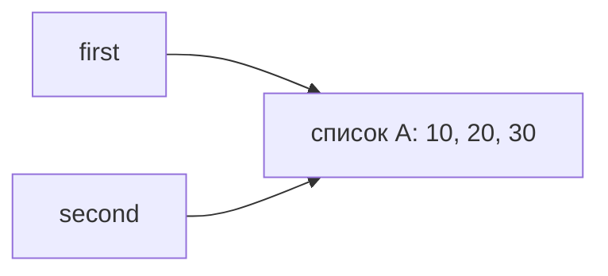
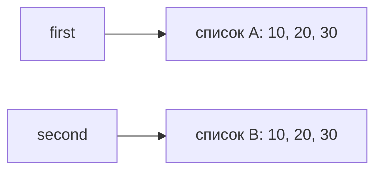

# Лабораторная 2 — объяснение с самого начала

Начнём с маленьких программ. Пока не нужно читать целиком файлы заданий: сначала разберём, что означают их основные действия. Примеры из разных шагов независимы. Внутри одного шага можно продолжать работать с уже созданными переменными.

Цель работы простая: научиться понимать, **что именно меняется при выполнении программы**, почему иногда изменение видно сразу в двух местах и почему одни данные занимают больше памяти, чем другие.

## Содержание

- [Начало с нуля](#начало-с-нуля)
- [Что означают обозначения в коде](#что-означают-обозначения-в-коде)
- [Задание 1 — имена и объекты](#задание-1--имена-и-объекты)
- [Задание 2 — копирование](#задание-2--копирование)
- [Задание 3 — сильные и слабые ссылки](#задание-3--сильные-и-слабые-ссылки)
- [Задание 4 — циклы и сборщик мусора](#задание-4--циклы-и-сборщик-мусора)
- [Задание 5 — измерение памяти](#задание-5--измерение-памяти)
- [Как рассказать работу на защите](#как-рассказать-работу-на-защите)
- [Проверка себя](#проверка-себя)
- [Что я должен понять после этой работы](#что-я-должен-понять-после-этой-работы)

## Начало с нуля

### Шаг 1 Переменная и вывод на экран

```python
age = 18
print(age)
```

Первая строка связывает имя `age` со значением 18. Вторая показывает это значение на экране:

```text
18
```

`age` — имя переменной. Вместо него можно было написать другое подходящее имя. `print()` — готовая функция Python для вывода. Круглые скобки содержат то, что нужно вывести.

В Python строки выполняются по порядку. Например:

```python
age = 18
age = 19
print(age)
```

Теперь результат — 19: мы заново связали имя `age` с другим значением. Это называется **переназначением**.

Текст пишется в кавычках: `name = 'Лев'`. Число 18 и текст `'18'` — разные виды данных, хотя при обычном выводе могут выглядеть похоже.

### Шаг 2 Что такое список и элемент

Список позволяет собрать несколько значений вместе:

```python
marks = [5, 4, 3]
print(marks)
```

Квадратные скобки `[...]` создают список, запятые разделяют его **элементы**. Здесь три элемента: число 5, число 4 и число 3. На экране будет `[5, 4, 3]`.

Чтобы взять один элемент, после имени пишут его номер в квадратных скобках:

```python
marks = [5, 4, 3]
print(marks[0])
print(marks[1])
print(marks[2])
```

Результат по строкам: 5, 4, 3. **Нумерация начинается с нуля:** `[0]` — первый элемент, `[1]` — второй, `[2]` — третий. Номер элемента называется индексом.

`len(marks)` вернёт 3 — количество элементов списка.

### Шаг 3 Как изменить список

```python
marks = [5, 4]
marks.append(3)
print(marks)
```

`append(3)` добавляет число 3 в конец уже существующего списка. Результат — `[5, 4, 3]`.

Можно заменить конкретный элемент:

```python
marks = [5, 4]
marks[0] = 2
print(marks)
```

Получится `[2, 4]`. Здесь изменили содержимое списка. Новый список вместо него не создавали.

Сравни две записи:

- `marks[0] = 2` — заменить первый элемент существующего списка.
- `marks = [2, 4]` — создать список и связать с ним имя `marks`.

По напечатанным элементам результат может выглядеть одинаково. Но для этой лабораторной важно, менялся ли старый список или имя стало указывать на другой.

### Шаг 4 Почему два имени могут показывать один список

```python
a = [5, 4]
b = a
b.append(3)
print(a)
print(b)
```

Обе строки вывода — `[5, 4, 3]`.

Причина: `b = a` **не создаёт копию списка**. Список один, просто обратиться к нему можно через два имени.

```text
a ──┐
    ├──> один список [5, 4, 3]
b ──┘
```

Здесь вводятся три термина, которые будут встречаться дальше:

- **Имя** — `a` или `b`.
- **Объект** — сами данные, например этот список. Число и строка тоже объекты Python.
- **Ссылка** — связь, через которую имя или другой объект позволяет обратиться к объекту.

Теперь сравни с отдельным примером:

```python
a = [5, 4]
b = [5, 4]
b.append(3)
print(a)
print(b)
```

Результат: `a` — `[5, 4]`, `b` — `[5, 4, 3]`. Здесь выражение `[5, 4]` выполнено два раза, поэтому созданы два отдельных списка.

### Шаг 5 Что значит изменяемый и неизменяемый

Список называют **изменяемым**, потому что можно менять его элементы, добавлять новые и удалять старые, сохраняя тот же объект списка.

Целое число называют **неизменяемым**. Посмотри:

```python
a = 10
b = a
a = a + 1
print(a)
print(b)
```

Результат: 11 и 10. Вычислилось число 11, имя `a` стало связано с результатом, а имя `b` осталось связано с 10. Сам объект числа 10 никто не переделывал в 11.

В таком примере `a += 1` — сокращённая запись увеличения числа. Но для разных типов объектов поведение `+=` может различаться, поэтому нельзя считать, что любая операция с любым объектом обязательно создаёт новый объект.

**Неизменяемое число не означает неизменяемую переменную:** имя можно переназначить, как в примере выше.

### Шаг 6 Что такое список внутри списка

В списке могут лежать не только числа, но и другие списки. Например, сохраним предметы с оценками:

```python
subjects = [
    ['Python', 5],
    ['Algorithms', 4],
]
```

Здесь:

- **Внешний список** — весь `subjects`. В нём два элемента.
- **Первый вложенный список** — `['Python', 5]`.
- **Второй вложенный список** — `['Algorithms', 4]`.

«Внутренний» или «вложенный» — значит просто «находящийся внутри другого списка». Никакого особого нового типа списка здесь нет.

```text
subjects — внешний список
    первый элемент  -> ['Python', 5]      — вложенный список
    второй элемент  -> ['Algorithms', 4]  — вложенный список
```

Разберём обращение к оценке:

```python
print(subjects[0])
print(subjects[0][1])
```

Первый вывод — `['Python', 5]`: взяли первый элемент внешнего списка. Второй вывод — 5: из полученного вложенного списка взяли второй элемент.

Следовательно, `subjects[0][1] = 3` означает: «В первом предмете замени оценку на 3».

Не путай два уровня изменения:

- `subjects.append(['Databases', 5])` — добавить предмет во внешний список.
- `subjects[0][1] = 3` — изменить оценку внутри уже существующего предмета.

### Шаг 7 Зачем бывают разные копии

Сначала возьмём список без вложенных списков:

```python
a = [5, 4]
b = a.copy()
b.append(3)
print(a)
print(b)
```

`copy()` создаёт другой внешний список. Поэтому `a` останется `[5, 4]`, а `b` станет `[5, 4, 3]`.

Теперь отдельный пример со списком внутри списка:

```python
a = [['Python', 5]]
b = a.copy()
b[0][1] = 3
print(a)
print(b)
```

Оба покажут `[['Python', 3]]`. У `a` и `b` внешние списки разные, но первый вложенный список **общий**. Обычный `copy()` скопировал внешний список, сохранив ссылки на его элементы. Это и называют **поверхностной копией**.

Если нужно независимо менять и вложенные списки, для этого примера подойдёт другая функция:

```python
from copy import deepcopy

a = [['Python', 5]]
b = deepcopy(a)
b[0][1] = 3
print(a)
print(b)
```

Первая строка подключает готовую функцию `deepcopy` из модуля `copy` стандартной библиотеки Python. Она здесь создаёт и отдельный внешний список, и отдельный вложенный список. Результат: `a` — `[['Python', 5]]`, `b` — `[['Python', 3]]`.

Это **глубокая копия**. Слово «глубокая» означает, что копирование затрагивает вложенные уровни структуры. Для начала достаточно понимать этот конкретный пример; ограничения такого копирования будут разобраны в задании 2.

| Запись | Что происходит в этих примерах |
|---|---|
| `b = a` | Ещё одно имя для того же списка |
| `b = a.copy()` | Другой внешний список, вложенные списки общие |
| `b = deepcopy(a)` | Другой внешний список и отдельные вложенные списки |

### Шаг 8 Что такое словарь в конфигурации проекта

Список позволяет находить значения по номеру, а **словарь** — по ключу. Например:

```python
project = {
    'name': 'Учебный проект',
    'members': ['Лев', 'Анна'],
}
print(project['name'])
print(project['members'])
```

Фигурные скобки `{...}` здесь создают словарь. Запись `'name': 'Учебный проект'` означает: ключ `'name'` связан со значением `'Учебный проект'`. На экране будут название и список участников.

В `project['members'].append('Иван')` сначала берётся список по ключу `'members'`, затем в этот список добавляется участник. В словаре тоже могут находиться изменяемые объекты. Поэтому вопрос о независимости копий важен и для него.

### Проверь, готов ли ты переходить к заданиям

Ответь себе на четыре вопроса:

1. Что означает `a[0]` для `a = [5, 4]`? — Первый элемент, то есть 5.
2. Создаёт ли `b = a` ещё один список? — Нет, появляется второе имя для того же списка.
3. Что такое внешний список в `a = [[1], [2]]`? — Сам `a`; его элементы — два вложенных списка `[1]` и `[2]`.
4. Почему `.copy()` может не защитить от изменения вложенной оценки? — Вложенный список остаётся общим.

Если эти ответы пока не понятны, вернись к соответствующему шагу. Остальная лабораторная строится на этих примерах.

## Что означают обозначения в коде

Эту таблицу можно использовать как справку по мере чтения, а не учить всю заранее.

| Запись | Что означает |
|---|---|
| `=` | Связать имя с результатом или заменить элемент контейнера — зависит от левой части записи |
| `==` | Сравнить значения; результат `True` означает «да», `False` — «нет» |
| `is` | Проверить, что это именно один объект, а не два равных по значениям |
| `is not` | Проверить, что объекты разные |
| `id(a)` | Получить идентификатор объекта; дальше сравниваются идентификаторы живущих одновременно объектов |
| `print(...)` | Показать значения на экране |
| `len(...)` | Получить число элементов |
| `# текст` | Комментарий для читателя |
| `"""текст"""` в начале файла | Краткое описание файла |
| `import sys` | Подключить модуль; его функцию вызывают, например, как `sys.getsizeof(...)` |
| `def name(...):` | Описать функцию; её действия выполнятся при вызове `name(...)` |
| `return value` | Вернуть результат из функции |
| `assert condition` | Проверить условие и остановиться с ошибкой, если оно ложно |
| `x and y` | Должны выполняться оба условия |
| `x or y` | Достаточно хотя бы одного из условий |
| `\n` внутри строки | Перевод строки при выводе |

`assert b == 10` проверяет, что `b` равно 10. Если проверка прошла, она ничего не печатает. В этой работе `assert` подтверждает результаты опытов. При запуске с параметром `-O` проверки могут быть отключены; обычный запуск — `python task_1.py`.

Строки с одинаковым отступом относятся к одному блоку. Например, действия внутри функции или цикла имеют отступ: это часть синтаксиса Python.

### Что вообще требуется сделать в этой лабораторной

Работа состоит из пяти опытов, а не из одной большой программы:

1. Проследить, что происходит с двумя именами одного числа или списка.
2. Сравнить способы копирования и объяснить ошибку со строками матрицы.
3. Посмотреть, какие ссылки удерживают объект в памяти.
4. Создать объекты, которые ссылаются друг на друга, и показать их удаление после потери доступа к ним.
5. Сравнить способы хранения чисел по расходу памяти.

Для каждого опыта нужно назвать прогноз, выполнить действия и объяснить результат. Ниже сначала идут объяснения, затем полный код соответствующего задания. Для задания 5 приведены оба его файла. Поэтому можно читать по порядку без переключения между файлами.

## Задание 1 — имена и объекты

### Сначала маленький пример

Если два имени указывают на один список, добавление элемента через одно имя видно через другое. Если одно имя переназначить на новый список, связь разделится. В этом задании сравнивается такое поведение списка с поведением целого числа.

### Часть A — почему `b` осталось равно 10

1. `a = 10` связывает имя `a` с числом 10.
2. `b = a` связывает `b` с тем же объектом: сначала `a is b` истинно.
3. `a += 1` вычисляет результат 11 и связывает с ним имя `a`.
4. Связь имени `b` никто не менял: оно по-прежнему указывает на 10.

Целые числа **неизменяемы**: нельзя превратить сам объект 10 в объект 11. При этом переменную `a` переназначать можно. Неизменяемость относится к объекту, а не к имени.

Ожидаемый результат: сначала `10 10` и одинаковые идентификаторы; затем `11 10` и разные идентификаторы. Сами длинные числа `id()` запоминать не нужно.

### Часть B — почему список поменялся через оба имени

`second = first` создаёт ещё одно имя для того же списка. `append(30)` меняет этот список на месте и не создаёт вместо него новый список.



Далее `second = [10, 20, 30]` создаёт новый список и переназначает только `second`.



После переназначения `first == second` даёт `True`: элементы равны. Но `first is second` даёт `False`: списки разные. Поэтому после `second.append(40)` получаем:

```text
first:  [10, 20, 30]
second: [10, 20, 30, 40]
```

`id()` идентифицирует объект во время его жизни. Если объекты существуют одновременно и `id()` одинаковы, это один объект. После удаления объекта его идентификатор со временем может использоваться снова, поэтому сравнивать старый сохранённый `id` с любым будущим объектом нельзя.

### Практическая часть — конфигурации проекта

`project` — словарь. В нём ключ `'name'` связан со строкой, `'members'` — со списком участников, `'parameters'` — со списком вложенных списков.

Разберём выражение `project['parameters'][1][1]` по шагам:

```text
project['parameters']       -> [['mode', 'debug'], ['workers', 1]]
project['parameters'][1]    -> ['workers', 1]
project['parameters'][1][1] -> 1
```

После `alias = project` это один словарь с двумя именами. Поэтому добавление Анны и установка режима `release` через `alias` видны и через `project`.

`independent = deepcopy(project)` создаёт независимую копию словаря и нужных вложенных изменяемых объектов. Она создаётся **после** добавления Анны и смены режима, поэтому эти значения уже входят в копию. Далее в копию добавляется Иван и меняется число исполнителей. В исходной конфигурации этих изменений нет.

Проверки `is not` подтверждают, что словари и вложенные списки разные. Последние проверки значений подтверждают, что исходные участники и число исполнителей сохранились.

### Короткий ответ для защиты

> Присваивание не копирует объект, а связывает с ним имя. Изменение общего списка видно через оба имени. Целое число изменить на месте нельзя, поэтому после `a += 1` имя `a` связано с результатом 11, а `b` остаётся связано с 10.

**Типичный вопрос:** «Меняет ли `second = first` сам список?» Ответ: нет, меняется связь имени `second`; содержимое списка эта инструкция не трогает.

### Полный код `task_1.py`

```python
"""Задание 1. Имена, ссылки и изменяемость."""
from copy import deepcopy


print('A. Прогноз: сначала id равны; после a += 1 получим 11 и 10.')
# Число нельзя изменить на месте.
a = 10
b = a
print('До:', a, b, 'id:', id(a), id(b))
a += 1
print('После:', a, b, 'id:', id(a), id(b))
assert a == 11 and b == 10 and a is not b

print('\nB. Прогноз: append изменит общий список; переназначение разделит списки.')
first = [10, 20]
# Здесь оба имени указывают на один список.
second = first
print('До append:', first, second, 'id:', id(first), id(second))
second.append(30)
print('После append:', first, second, 'id:', id(first), id(second))
assert first is second and first == [10, 20, 30]
second = [10, 20, 30]
print('После переназначения:', first, second, 'id:', id(first), id(second))
print('==:', first == second, 'is:', first is second)
assert first == second and first is not second
second.append(40)
print('После изменения нового списка:', first, second)
assert first == [10, 20, 30] and second == [10, 20, 30, 40]

print('\nКонфигурации. Прогноз: присваивание оставляет объекты общими, deepcopy изолирует изменения.')
project = {'name': 'Учебный проект', 'members': ['Лев'],
           'parameters': [['mode', 'debug'], ['workers', 1]]}
alias = project
print('project до:', project)
print('alias до:', alias)
alias['members'].append('Анна')
alias['parameters'][0][1] = 'release'
print('project после:', project)
print('alias после:', alias)
assert alias is project
# Копируем и словарь, и вложенные списки.
independent = deepcopy(project)
print('project до:', project)
print('independent до:', independent)
independent['name'] = 'Второй проект'
independent['members'].append('Иван')
independent['parameters'][1][1] = 4
print('project после:', project)
print('independent после:', independent)
assert independent is not project
assert independent['members'] is not project['members']
assert independent['parameters'] is not project['parameters']
assert independent['parameters'][0] is not project['parameters'][0]
assert independent['parameters'][1] is not project['parameters'][1]
assert project['members'] == ['Лев', 'Анна']
assert project['parameters'][1][1] == 1
print('Итог: alias и project общие; изменяемые объекты independent независимы.')
```

## Задание 2 — копирование

### Что здесь сравнивается

У вложенного списка есть два уровня: внешний список предметов и отдельные строки с предметом и оценкой. Можно скопировать только первый уровень или также вложенные изменяемые объекты.

### Зачем нужна `show_lists()`

Функция только печатает текущее состояние списков и их идентификаторы. Запись `def show_lists():` сохраняет описание действий; выполнение происходит при вызове `show_lists()`.

Она читает имена `original`, `alias`, `shallow`, `deep` из уровня файла. К моменту первого вызова эти имена уже созданы. Если вызвать функцию раньше создания списков, возникнет `NameError`. Проверять нужно порядок вызова, а не только место определения функции.

### Три способа получить второй список

| Строка | Внешний список | Вложенные списки |
|---|---|---|
| `alias = original` | Тот же | Те же |
| `shallow = original.copy()` | Новый | Общие с исходным |
| `deep = copy.deepcopy(original)` | Новый | Отдельные в этом примере |

После `original.append(['Databases', 5])` меняется **внешний** список. Поэтому новый предмет появляется только у `original` и `alias`.

После `original[0][1] = 3` меняется **первый вложенный список**. Он общий у `original`, `alias`, `shallow`, поэтому все три показывают оценку 3. В `deep` остаётся оценка 5.

| Этап | `original` | `alias` | `shallow` | `deep` |
|---|---|---|---|---|
| После `append` | 3 предмета | 3 предмета | 2 предмета | 2 предмета |
| После замены оценки | Python: 3 | Python: 3 | Python: 3 | Python: 5 |

`original[0][1] = 3` заменяет ссылку на оценку внутри строки. Сам объект числа 5 при этом не превращается в 3. До изменения неизменяемое число 5 может быть общим даже с глубокой копией — для независимости списков создавать отдельные копии каждого целого числа не требуется.

### Почему ошибочная матрица меняется сразу в трёх строках

`[0] * 3` создаёт строку `[0, 0, 0]`. Внешнее умножение в `[[0] * 3] * 3` повторяет ссылку на эту строку три раза. Поэтому `wrong_matrix[0] is wrong_matrix[1]` истинно.

После `wrong_matrix[0][0] = 1` меняется один объект строки, который виден в трёх местах:

```text
[[1, 0, 0], [1, 0, 0], [1, 0, 0]]
```

В `[[0] * 3 for _ in range(3)]` выражение `[0] * 3` выполняется заново три раза. Получаются отдельные строки, поэтому изменится только первая. `_` — обычное имя переменной цикла; так показывают, что её значение здесь не нужно. Цикл `for row in ...` ниже просто выводит `id()` каждой строки.

### Когда какой способ выбирать

Если нужно независимое добавление предметов, но вложенные строки меняться не будут, достаточно поверхностной копии. Если нужно независимо менять и оценки во вложенных строках, в этой структуре подходит глубокая копия.

`deepcopy()` не стоит применять автоматически: копирование большой структуры тратит время и память, может скопировать данные, которые должны быть общими; некоторые ресурсы, например открытые файлы, так копировать нельзя. Также глубокая копия может сохранить повторные ссылки внутри самой копии: она не обязана превращать каждое вхождение одного объекта в отдельный объект.

### Короткий ответ для защиты

> Поверхностная копия создаёт новый внешний контейнер, но сохраняет ссылки на вложенные объекты. Поэтому вложенное изменение видно и в исходном списке. Глубокая копия даёт отдельные вложенные списки в нашем примере. Ошибка матрицы тоже связана с повторением ссылок на один изменяемый объект.

### Полный код `task_2.py`

```python
"""Задание 2. Копирование списков."""
import copy


def show_lists():
    # Эта функция только показывает четыре списка и их id.
    print('original:', original)
    print('alias:', alias)
    print('shallow:', shallow)
    print('deep:', deep)
    print('id внешних списков:')
    print(id(original), id(alias), id(shallow), id(deep))
    print('id первых вложенных списков:')
    print(id(original[0]), id(alias[0]), id(shallow[0]), id(deep[0]))
    print('id первых оценок:')
    print(id(original[0][1]), id(alias[0][1]), id(shallow[0][1]), id(deep[0][1]))


print('Прогноз: append увидит alias; замену оценки увидят alias и shallow; deep не изменится.')
original = [['Python', 5], ['Algorithms', 4]]
alias = original
shallow = original.copy()
deep = copy.deepcopy(original)

print('До изменений:')
show_lists()

original.append(['Databases', 5])
print('После append:')
show_lists()
assert len(alias) == 3
assert len(shallow) == 2
assert len(deep) == 2

original[0][1] = 3
print('После изменения оценки:')
show_lists()
assert alias is original
assert shallow is not original
assert shallow[0] is original[0]
assert deep[0] is not original[0]
assert shallow[0][1] == 3
assert deep[0][1] == 5

print('Прогноз: в wrong_matrix изменятся три строки, в correct_matrix только первая.')
wrong_matrix = [[0] * 3] * 3
correct_matrix = [[0] * 3 for _ in range(3)]
print('До:', wrong_matrix, correct_matrix)
print('id строк wrong_matrix:')
for row in wrong_matrix:
    print(id(row))
print('id строк correct_matrix:')
for row in correct_matrix:
    print(id(row))
wrong_matrix[0][0] = 1
correct_matrix[0][0] = 1
print('После:', wrong_matrix, correct_matrix)
assert wrong_matrix == [[1, 0, 0], [1, 0, 0], [1, 0, 0]]
assert correct_matrix == [[1, 0, 0], [0, 0, 0], [0, 0, 0]]
```

## Задание 3 — сильные и слабые ссылки

### Что мы хотим выяснить

В задании 1 один список мог иметь два имени. Теперь вопрос другой: **если убрать одно имя, останется ли сам список? А если убрать все способы к нему обратиться?**

Сначала разберём это без счётчиков, классов и дополнительных модулей.

### Шаг 1 Удалить имя и удалить данные — разные действия

```python
data = [1, 2, 3]
alias = data
del alias
print(data)
```

Читаем сверху вниз:

1. Создали список и назвали его `data`.
2. Дали этому же списку ещё одно имя — `alias`.
3. `del alias` убрало имя `alias`.
4. Имя `data` осталось, поэтому список можно напечатать.

Результат — `[1, 2, 3]`. Команда `del` здесь не означает «уничтожь список независимо от всего остального». Она означает «убери эту связь имени с данными».

Обычная связь имени с объектом называется **сильной ссылкой**: она удерживает объект. Пока такая ссылка нужна программе и существует, объект должен оставаться доступен.

### Шаг 2 Объект может удерживать не только имя

```python
data = [1, 2, 3]
container = [data]
print(container)
```

Результат — `[[1, 2, 3]]`. Внешний список `container` содержит ссылку на уже существующий список `data`. Он не копирует три числа в отдельную строку списка.

Здесь к исходному списку ведут две сильные ссылки: имя `data` и элемент списка `container`. Это понадобится для следующего опыта.

### Шаг 3 Теперь посчитаем ссылки в настоящем коде

В Python есть готовые инструменты, собранные в **модули**. Чтобы использовать инструмент из модуля, его подключают через `import`. Модуль `sys` содержит функцию `getrefcount()`, которая показывает счётчик ссылок на переданный объект.

```python
import sys

data = [1, 2, 3]
start = sys.getrefcount(data)
print('После создания:', start)

alias = data
after_alias = sys.getrefcount(data)
print('После создания alias:', after_alias)

container = [data]
after_container = sys.getrefcount(data)
print('После помещения в контейнер:', after_container)

del alias
after_del = sys.getrefcount(data)
print('После del alias:', after_del)

container.clear()
after_clear = sys.getrefcount(data)
print('После очистки контейнера:', after_clear)
```

`container.clear()` очищает внешний список: убирает из него элементы, а вместе с ними — их ссылки на данные. Само имя `data` при этом остаётся.

В нашем CPython 3.11.9 вывод такой:

```text
После создания: 2
После создания alias: 3
После помещения в контейнер: 4
После del alias: 3
После очистки контейнера: 2
```

Почему сначала 2, хотя мы написали только одно имя? В этом запуске сам вызов `getrefcount(data)` на время работы добавляет ссылку на аргумент. В CPython 3.14.7 наш опыт дал `1, 2, 3, 2, 1`, поэтому запоминать начальное число не нужно. Главное: каждое из двух добавлений увеличило счётчик на 1, а каждое удаление уменьшило на 1.

`start`, `after_alias` и остальные переменные хранят **полученные числа**, а не дополнительные копии или ссылки на исходный список.

### Шаг 4 Зачем здесь `assert`

Мы уже увидели ожидаемые числа. Теперь программа может сама проверить, что результат получился правильным:

```python
assert after_alias == start + 1
```

Это читается: «Проверь, что после добавления имени ссылок стало на одну больше».

Если условие верно, выполнение просто продолжается. Если неверно, Python сообщает об ошибке `AssertionError` и обычное выполнение дальше прерывается. Так мы замечаем, что опыт дал неожиданный результат. `assert` не добавляет ссылку и не освобождает память — он только проверяет условие.

### Шаг 5 Что значит слабая ссылка

До этого все рассмотренные ссылки удерживали объект. **Слабая ссылка** устроена иначе: она позволяет спросить «объект ещё существует?», но сама не требует хранить его в памяти.

Для этого опыта нужен простой объект подходящего типа. Мы создаём такой тип самостоятельно:

```python
import weakref

class Record:
    pass

record = Record()
weak_record = weakref.ref(record)
print(weak_record() is record)
del record
print(weak_record())
```

Теперь по строкам:

| Строка | Что здесь происходит |
|---|---|
| `import weakref` | Подключаем готовые инструменты слабых ссылок |
| `class Record:` | Описываем собственный тип объектов с именем `Record` |
| `pass` | Внутри описания пока нет дополнительных действий; нужен допустимый пустой блок |
| `record = Record()` | Создаём один объект этого типа и даём ему обычное имя `record` |
| `weak_record = weakref.ref(record)` | Создаём слабую ссылку на этот объект |
| `weak_record()` | Спрашиваем у слабой ссылки, существует ли ещё объект; она вернёт объект или `None` |
| `del record` | Убираем единственную обычную сильную ссылку из нашего примера |

В этом опыте результат — сначала `True`, затем `None`. `None` — специальное значение Python, здесь означающее отсутствие живого объекта за слабой ссылкой.

Класс `Record` не является дополнительным способом удерживать каждый его экземпляр: удаление имени экземпляра — отдельная история от существования описания типа. Мы используем этот простой класс потому, что его экземпляры поддерживают слабые ссылки, а обычный встроенный список напрямую — нет.

Если бы перед `del record` было ещё `saved = record`, объект оставался бы доступен через `saved`, и слабая ссылка продолжала бы его возвращать.

### Шаг 6 Что делает слабый реестр в практической части

**Реестр** здесь — просто таблица «имя записи → объект». Для неё используется специальный словарь `WeakValueDictionary`: он хранит свои значения через слабые ссылки.

Этот фрагмент продолжает пример выше: модуль `weakref` и класс `Record` уже определены.

```python
registry = weakref.WeakValueDictionary()
first = Record()
second = Record()
temporary = Record()

registry['first'] = first
registry['second'] = second
registry['third'] = temporary
print(sorted(registry))

del temporary
print(sorted(registry))

del second
print(sorted(registry))
```

По порядку получаются:

```text
['first', 'second', 'third']
['first', 'second']
['first']
```

Сначала три объекта удерживаются обычными именами. После удаления `temporary` третий объект больше никто сильно не удерживает, и его запись исчезает из слабого словаря. Затем то же происходит со вторым объектом.

`sorted(registry)` получает ключи словаря и выводит их по порядку. В полном файле `set(registry)` используется, чтобы проверить набор ключей без учёта порядка. Слова `'first'` и `'third'` в ключах — текстовые названия записей; они сами не являются сильными ссылками на объекты-значения.

Практический смысл: такой словарь подходит для кеша картинок, если кеш **не должен сам удерживать картинки**, которые больше никому не нужны. Если объект обязательно должен сохраняться, нужна сильная ссылка.

### Что показать и сказать на защите задания 3

Покажи изменение счётчика после `alias = data`, затем исчезновение `'third'` из реестра после `del temporary`.

> Я проверил, что новое имя и элемент контейнера добавляют сильные ссылки. `del` убирает имя, а не обязательно сам объект. Слабый словарь объект не удерживает, поэтому запись исчезает после удаления последней сильной ссылки.

Освобождение объекта не обязательно означает немедленный возврат памяти операционной системе: Python может использовать освободившееся место повторно. Это отдельный вопрос от того, существует ли сам объект.

### Полный код `task_3.py`

Ниже тот же опыт целиком, включая прогнозы и проверки. Его части уже разобраны выше.

```python
"""Задание 3. Сильные и слабые ссылки в CPython."""
import sys
import weakref


class Record:
    pass


print('Прогноз: относительно начала счетчик изменится на +1, +2, +1, 0.')
data = [1, 2, 3]
start = sys.getrefcount(data)
print('После создания:', start)
alias = data
after_alias = sys.getrefcount(data)
print('После создания alias:', after_alias)
container = [data]
after_container = sys.getrefcount(data)
print('После помещения в контейнер:', after_container)
del alias
after_del = sys.getrefcount(data)
print('После del alias:', after_del)
container.clear()
after_clear = sys.getrefcount(data)
print('После очистки контейнера:', after_clear)
assert after_alias == start + 1
assert after_container == start + 2
assert after_del == start + 1
assert after_clear == start

print('\nПрогноз: после del record слабая ссылка вернет None.')
record = Record()
# Слабая ссылка позволяет найти объект, но не удерживает его.
weak_record = weakref.ref(record)
print('До удаления:', weak_record())
assert weak_record() is record
del record
print('После удаления:', weak_record())
assert weak_record() is None

print('\nРеестр. Прогноз: останутся first и second, затем только first.')
registry = weakref.WeakValueDictionary()
first = Record()
second = Record()
temporary = Record()
registry['first'] = first
registry['second'] = second
registry['third'] = temporary
print('Три сильные ссылки:', sorted(registry))
assert len(registry) == 3
# У третьего объекта больше не останется сильных ссылок.
del temporary
print('После удаления temporary:', sorted(registry))
assert set(registry) == {'first', 'second'}
del second
print('После удаления second:', sorted(registry))
assert set(registry) == {'first'} and registry['first'] is first
print('Итог: слабый реестр не продлевает жизнь объектов; пример применения — кеш.')
```

## Задание 4 — циклы и сборщик мусора

### Что мы хотим выяснить

В задании 3 объект освобождался, когда исчезала последняя сильная ссылка. Теперь создадим ситуацию, где **два объекта держат друг друга**, хотя программа уже не может к ним обратиться.

### Шаг 1 Создадим две взаимные ссылки

```python
first = []
second = []
first.append(second)
second.append(first)
```

Первая строка создаёт пустой список, вторая — другой пустой список. Третья помещает во `first` ссылку на `second`. Четвёртая помещает в `second` ссылку на `first`.

```text
first  -> список A
second -> список B

Связи между списками: A -> B -> A
```

Проще словами: A ведёт к B, B ведёт обратно к A. Такой замкнутый путь называется **циклом ссылок**. Удобнее нарисовать его прямо: `A -> B -> A`.

Проверим конкретные связи:

```python
print(first[0] is second)
print(second[0] is first)
```

Обе строки дадут `True`: первый элемент каждого списка — именно второй список, а не его копия.

### Шаг 2 Что будет после удаления внешних имён

Продолжим предыдущий пример:

```python
del first, second
```

Это сокращённая запись удаления двух имён. Имена снаружи исчезли, но A всё ещё ссылается на B, а B — на A. Внутри цикла ссылки остаются.

**Недостижимый объект** — объект, до которого уже нельзя добраться из выполняющейся программы по оставшимся ссылкам. В нашем примере недостижимой стала вся пара, но внутренние счётчики ещё ненулевые. Поэтому одного подсчёта ссылок недостаточно.

### Шаг 3 Зачем нужен сборщик мусора и модуль `gc`

В CPython есть дополнительный механизм, который умеет находить недостижимые циклы. Он называется **циклическим сборщиком мусора**. «Мусор» здесь — данные, к которым программа уже потеряла доступ.

Через модуль `gc` можно управлять этим механизмом. Вот маленький полный опыт:

```python
import gc

gc.collect()
first = []
second = []
first.append(second)
second.append(first)
del first, second
collected = gc.collect()
print(collected)
```

Первый вызов `gc.collect()` убирает ранее накопившийся мусор перед опытом. Второй запускает ручной поиск недостижимых объектов после удаления имён. Возвращённое число сохраняется в `collected` и печатается. В нашем запуске это 2 — два списка. Это число объектов, а не количество байтов; в другой среде туда может попасть и другой мусор.

Наличие цикла само по себе не означает, что его надо удалить. Если оставить `saved = first` перед удалением имён, через `saved` будут доступны оба списка. Такой доступный цикл ещё нужен программе.

### Шаг 4 Зачем выключать автоматическую сборку

Обычно Python запускает циклическую сборку автоматически. Но мы проводим опыт и хотим увидеть результат **своего ручного вызова**, а не обнаружить, что всё уже собрано раньше.

Поэтому в дополнительном опыте используются три команды:

| Команда | Значение |
|---|---|
| `gc.disable()` | Временно выключить автоматическую циклическую сборку |
| `gc.collect()` | Выполнить ручную сборку сейчас |
| `gc.enable()` | Включить автоматическую сборку обратно |

`disable()` не отключает вообще всё управление памятью: обычный подсчёт ссылок продолжает работать. Ручной вызов `collect()` также остаётся доступен.

### Шаг 5 Сначала поймём проблему без `try/finally`

На первый взгляд достаточно такого порядка:

```python
gc.disable()
# Здесь создаём циклы и выполняем проверки.
gc.collect()
gc.enable()
```

Если всё идёт нормально, последняя строка включит сборщик обратно. Но Python может встретить ошибку и прервать выполнение **до последней строки**.

Что такое ошибка в данном случае? Например, проверка `assert manual >= 5` ожидала хотя бы пять собранных объектов, а получила меньше. Тогда `assert` сообщает `AssertionError`, и следующая обычная строка не выполняется. Другой простой пример ошибки — попытка разделить число на ноль.

В итоге команда `gc.disable()` уже сработала, а до `gc.enable()` программа не дошла. Нужно указать Python, что включение обратно — обязательное завершающее действие.

### Шаг 6 Теперь появляется `try/finally`

Рассмотрим укороченный рабочий фрагмент с одним циклом:

```python
import gc

gc.disable()
try:
    cycle = []
    cycle.append(cycle)
    del cycle
    manual = gc.collect()
    print(manual)
finally:
    gc.enable()
```

Здесь есть два блока с отступами:

- После `try:` стоят обычные действия нашего опыта: создать список, замкнуть его на себя, убрать имя и запустить ручную сборку.
- После `finally:` стоит действие, которое Python выполнит после выхода из первого блока — и при нормальном завершении, и при обычной ошибке во время выполнения.

То есть для этого кода смысл такой: **«Выключи автоматическую сборку. Проведи опыт. При выходе из опыта обязательно включи её обратно»**.

Если ошибка возникнет внутри `try`, блок `finally` не стирает ошибку и не делает проверку успешной. Он сначала включает сборщик обратно, после чего ошибка продолжает передаваться дальше. Речь об обычном выполнении Python: аварийное завершение всего процесса не даёт такой гарантии.

Теперь фраза «`gc.enable()` не будет пропущен из-за неудачного `assert`» означает конкретно это: проверка может прервать опыт, но завершающий блок всё равно восстановит настройку.

В полном файле стоит `for _ in range(5)`: он повторяет создание списка со ссылкой на себя пять раз. Значение `_` не используется; важно количество повторений. В нашем запуске ручная сборка собрала 5 объектов.

### Шаг 7 Что показывают команды в начале полного файла

В полном коде сначала печатается состояние сборщика:

```python
print('Автоматическая сборка включена:', gc.isenabled())
print('Пороги:', gc.get_threshold())
print('Статистика поколений:', gc.get_stats())
```

`isenabled()` отвечает `True` или `False`: включена ли автоматическая сборка. `get_threshold()` показывает настройки, влияющие на её запуск. Это не лимит памяти в байтах. `get_stats()` показывает статистику, например количество уже выполненных сборок.

Слово **поколения** относится к способу организации проверки объектов: новые объекты обычно проверяются чаще, долго живущие — реже. Детали зависят от версии CPython. Для защиты нужно понимать назначение, а не запоминать `(700, 10, 10)` как правило на все версии.

В файле также сохраняются `first_id` и `second_id` — числовые идентификаторы списков. Это просто числа: они не удерживают списки и не позволяют безопасно получить их обратно после удаления.

### Шаг 8 Что за граф из узлов A B C D

**Граф** здесь — несколько объектов и связи между ними. **Узел** — один из этих объектов. В нашей программе каждый узел хранится в словаре:

```python
a = {'name': 'A', 'links': []}
```

Ключ `'name'` содержит название, а `'links'` — список ссылок на соседние узлы. Например, `a['links'].append(b)` означает: взять список связей узла A и добавить туда ссылку на узел B.

Такой фрагмент создаёт все связи:

```python
a = {'name': 'A', 'links': []}
b = {'name': 'B', 'links': []}
c = {'name': 'C', 'links': []}
independent = {'name': 'D', 'links': []}

a['links'].append(b)
b['links'].append(c)
c['links'].append(a)
```

Схема: `A -> B -> C -> A`, а D стоит отдельно. У трёх узлов есть три словаря и три списка связей — шесть объектов в цикле.

После `del a, b, c` цикл становится недостижимым. В нашем опыте сборка до его создания вернула 0, после удаления имён — 6. D остаётся доступен через `independent`, и проверка подтверждает, что он сохранился. Этот опыт тоже находится внутри `try/finally`, чтобы восстановить автоматическую сборку.

### Что показать и сказать на защите задания 4

Покажи две строки с `append`, удаление внешних имён и результат `gc.collect()`. Затем покажи `gc.enable()` внутри `finally`.

> Я создал объекты, которые ссылаются друг на друга. После удаления внешних имён внутри цикла ссылки остаются, но доступа из программы уже нет. Такие объекты находит циклический сборщик. На время опыта я выключаю автоматическую сборку и обязательно включаю её обратно через `finally`.

Постоянно вызывать `gc.collect()` вручную в обычной программе не требуется: в этой работе ручной запуск нужен, чтобы увидеть механизм.

### Полный код `task_4.py`

```python
"""Задание 4. Недостижимые циклы и ручная сборка мусора."""
import gc


print('Автоматическая сборка включена:', gc.isenabled())
print('Пороги:', gc.get_threshold())
print('Статистика поколений:', gc.get_stats())
print('\nПрогноз: после удаления внешних имен цикл останется до сборки GC.')
gc.collect()  # Убираем мусор, накопленный до эксперимента.
first = []
second = []
first.append(second)
second.append(first)
print('first ссылается на second:', first[0] is second)
print('second ссылается на first:', second[0] is first)
first_id, second_id = id(first), id(second)
print('Запомненные id:', first_id, second_id)
del first, second
collected = gc.collect()
print('Собрано после удаления имен:', collected)

print('\nПрогноз: ручная сборка работает даже при отключенной автоматической.')
gc.disable()
try:
    for _ in range(5):
        cycle = []
        cycle.append(cycle)
        del cycle
    print('Автоматическая сборка включена:', gc.isenabled())
    manual = gc.collect()
    print('Собрано из пяти циклов:', manual)
    assert manual >= 5
finally:
    # Включаем автоматическую сборку даже при ошибке.
    gc.enable()
print('Автоматическая сборка восстановлена:', gc.isenabled())

print('\nГраф. Прогноз: A -> B -> C -> A недостижим; D останется доступен.')
gc.disable()  # Не даем автоматической сборке опередить измерение.
try:
    before = gc.collect()
    a = {'name': 'A', 'links': []}
    b = {'name': 'B', 'links': []}
    c = {'name': 'C', 'links': []}
    independent = {'name': 'D', 'links': []}
    a['links'].append(b)
    b['links'].append(c)
    c['links'].append(a)
    print('Связи:', a['name'], '->', b['name'], '->', c['name'], '->', a['name'])
    print('Независимый узел:', independent)
    del a, b, c
    after = gc.collect()
    print('Собрано до графа / после удаления графа:', before, after)
    assert after >= 6  # Три словаря и три списка связей.
    assert independent == {'name': 'D', 'links': []}
    print('После сборки узел D доступен:', independent)
finally:
    # Включаем автоматическую сборку даже при ошибке.
    gc.enable()
print('Итог: GC удаляет недостижимые циклы, достижимый D сохранен.')
```

## Задание 5 — измерение памяти

### Что мы хотим выяснить

Когда программа создаёт список, число или строку, эти данные занимают место в оперативной памяти. Сейчас мы измеряем это место, а не размер файла `.py` на диске.

В задании три вопроса: сколько занимает сам объект, как растёт список при добавлениях и чем большой готовый список чисел отличается от `range` по расходу памяти.

### Шаг 1 Измерим размер одного списка

```python
import sys

numbers = [1, 2, 3]
size = sys.getsizeof(numbers)
print(size)
```

`import sys` подключает модуль. `sys.getsizeof(numbers)` возвращает размер самого объекта списка **в байтах**. Результат сохраняется в `size`, затем выводится. Число зависит от версии Python и способа создания списка.

Байт — единица измерения объёма данных. 1024 байта составляют 1 КиБ. Пока достаточно помнить, что больше байтов — больше занятого места.

Список хранит ссылки на свои элементы. Поэтому размер самого списка не включает полную память всех объектов-элементов. Это похоже на размер списка адресов: он не равен размеру всех вещей, которые находятся по этим адресам.

В лабораторной таким способом измеряются пустой список, список десяти чисел, кортеж, строка, число и `None`. **Кортеж** похож на список значений, но его элементы нельзя заменить на месте. `None` — специальное значение отсутствия результата или данных; оно тоже является объектом.

### Шаг 2 Список может заранее выделять место с запасом

```python
import sys

numbers = []
old_size = sys.getsizeof(numbers)
print(0, old_size)

for number in range(10):
    numbers.append(number)
    size = sys.getsizeof(numbers)
    if size != old_size:
        print(len(numbers), size)
        old_size = size
```

Разберём новые действия:

- `range(10)` задаёт последовательность чисел от 0 до 9.
- `for number in range(10)` по очереди берёт эти числа и повторяет строки с отступом для каждого.
- `numbers.append(number)` добавляет очередное число в список.
- `if size != old_size` означает: «Если новый размер не равен предыдущему».
- При изменении размера выводятся длина и размер, затем `old_size` обновляется.

В нашем CPython 3.11.9 для этого примера получатся пары:

```text
длина   размер в байтах
0       56
1       88
5       120
9       184
```

После первого добавления список получил запас места. На длинах 2, 3 и 4 его внешний размер ещё не изменялся. Это уменьшает необходимость перевыделять массив ссылок после каждого добавления.

**Длина** — сколько элементов сейчас, **выделенная память** — сколько места уже отведено, включая запас. В полном задании выполняются не 10, а 100 добавлений, а результаты сначала сохраняются и только потом печатаются.

### Шаг 3 Что такое текущая и пиковая память

Размер одного объекта — ещё не вся информация. Во время создания структуры могли появляться временные объекты, которые потом исчезли.

Для наблюдения используется модуль `tracemalloc`. Слово **трассировка** ниже означает отслеживание выделений памяти после включения этого инструмента.

```python
import tracemalloc

tracemalloc.start()
numbers = list(range(100_000))
current, peak = tracemalloc.get_traced_memory()
tracemalloc.stop()

print('Сейчас:', current)
print('Максимум:', peak)
```

| Строка | Что делает |
|---|---|
| `tracemalloc.start()` | Начинает отслеживать выделения памяти |
| `list(range(100_000))` | Создаёт готовый список чисел от 0 до 99 999 |
| `get_traced_memory()` | Возвращает два числа в байтах |
| `current, peak = ...` | Сохраняет первое число в `current`, второе в `peak` |
| `tracemalloc.stop()` | Останавливает отслеживание |

`current` — сколько отслеженной памяти занято в момент запроса. `peak` — наибольшее количество одновременно занятой отслеженной памяти с начала измерения. Если временная память уже освободилась, текущий размер может быть меньше пика.

Инструмент не измеряет всю оперативную память процесса и не учитывает автоматически всё, что было создано до `start()`. Поэтому `getsizeof()` и `tracemalloc` измеряют разные вещи и могут давать разные числа.

Подчёркивание в `100_000` только помогает читать число: это то же самое, что `100000`.

### Шаг 4 Зачем сравниваются `list` и `range`

```python
numbers = list(range(100_000))
```

Здесь создаётся большой список с готовыми значениями. А здесь:

```python
numbers = range(100_000)
```

Создаётся компактное описание последовательности: начало, граница и шаг. Все сто тысяч чисел заранее хранить не требуется — они получаются по мере обращения. В обоих случаях `len(numbers)` равно 100 000, но способ представления данных разный.

`range` — отдельный тип последовательности, не генератор. Он удобен для перебора чисел; если нужны операции изменения списка, он не заменит список во всём.

В нашем CPython 3.11.9 сравнение получилось таким:

| Представление | Внешний размер, байт | Текущая память, КиБ | Пиковая память, КиБ |
|---|---:|---:|---:|
| `list(range(100000))` | 800056 | 3898.2734 | 3898.3828 |
| `range(100000)` | 48 | 0.0781 | 0.1250 |

Для перевода байтов в КиБ результат делят на 1024. Отношение пиков означает «во сколько раз один измеренный пик больше другого»: `пик списка / пик range`. В этом запуске — примерно 31187,06.

В нашем CPython 3.14.7 отслеженный пик `range` оказался равен нулю. Это не значит, что объект совсем не занимает память. На ноль делить нельзя, поэтому программа сообщает, что отношение в таком измерении не определено. Мы сравниваем память, а не скорость работы.

### Шаг 5 Зачем измерения обёрнуты в функции

Полная программа длиннее маленьких примеров, поэтому повторяющиеся действия получили имена — **функции**. Сначала разберём сам механизм на коротком примере:

```python
def add_one(number):
    result = number + 1
    return result

answer = add_one(5)
print(answer)
```

`def` описывает действия, но ещё не выполняет их. `number` — имя для значения, которое передадут при вызове. В `add_one(5)` передано число 5, поэтому внутри функции вычисляется 6. `return` возвращает его наружу, в `answer` сохраняется 6, и `print()` выводит 6.

Теперь можно прочитать названия функций нашей программы:

| Функция | Обычными словами |
|---|---|
| `measure(name)` | Измерить один выбранный объект и вернуть числа |
| `collect_measurements()` | Собрать результаты всех опытов |
| `print_report(...)` | Напечатать уже собранные результаты |
| `main()` | Запустить эти шаги в нужном порядке |

Это наши названия, а не специальные команды языка. Специальные слова языка здесь — например, `def`, `if`, `return`, `try`, `finally`.

### Шаг 6 Разбор `measure()` маленькими частями

При вызове `measure('Пустой список')` в переменную `name` внутри функции попадёт текст `'Пустой список'`. Условия `if/elif` выберут подходящий объект. `elif` означает «иначе, если»: проверяется следующий вариант, когда предыдущий не подошёл.

Вот сокращение настоящей функции до одного варианта:

```python
def measure(name):
    tracemalloc.start()
    try:
        value = []
        current, peak = tracemalloc.get_traced_memory()
        size = sys.getsizeof(value)
        count = len(value)
    finally:
        tracemalloc.stop()

    return {'name': name, 'count': count, 'size': size,
            'current': current, 'peak': peak}
```

Этот фрагмент использует уже подключённые `sys` и `tracemalloc`. В полной функции вместо одного `value = []` есть выбор из восьми вариантов.

Теперь `try/finally` выполняет ту же роль, что в задании 4: **начали измерение → выполнили действия → при выходе обязательно остановили измерение**. Если внутри произойдёт обычная ошибка, `finally` вызовет `stop()`, а ошибка продолжит передаваться дальше. В этом случае строка `return` с обычным результатом не выполняется.

Возвращается словарь. Например, запись `'size': size` связывает текстовый ключ `'size'` с числом из переменной `size`. Так у каждого числа есть подпись.

В полной функции для числа 42 и `None` указывается `count = 1`: это договорённость отчёта, потому что `len(42)` и `len(None)` не определены. Строка `''.join(['a'] * 10)` создаёт строку из десяти букв `a`: список из десяти `'a'` соединяется без разделителя.

`raise ValueError('Неизвестный сценарий')` означает: «Сообщить об ошибке, если передано название, которое функция не знает». Это защищает от попытки продолжить измерение без выбранного объекта.

### Шаг 7 Где хранятся результаты до вывода

В `collect_measurements()` список `names` содержит восемь названий опытов. Затем выполняется:

```python
results = []
for name in names:
    results.append(measure(name))
```

Для каждого названия вызывается `measure()`. Она возвращает словарь с числами, и этот словарь добавляется в список `results`.

Поэтому `results[6]['peak']` читается в два шага:

1. `results[6]` — взять седьмой результат, потому что счёт начинается с нуля.
2. `['peak']` — из этого словаря взять число с подписью `'peak'`.

В нашем порядке седьмой опыт — большой список, восьмой — `range`. Отсюда индексы 6 и 7 при расчёте отношения.

Из опыта с ростом списка сохраняются пары `[длина, размер]` в отдельный список `growth`. Начальная пара — `[0, old_size]`. После всех опытов функция возвращает `results`, `growth`, `ratio` — результаты, рост списка и отношение пиков.

В `for length, size in growth` каждая сохранённая пара разделяется на две переменные. Например, из `[5, 120]` получится `length = 5`, `size = 120`.

### Шаг 8 Почему здесь два файла и что запускается первым

В `memory_report.py` описаны все измерения. `task_5.py` только подключает функцию `main()` из соседнего файла и запускает её. Это позволяет не писать одинаковые измерения дважды.

```python
from memory_report import main

if __name__ == '__main__':
    main()
```

`__name__` — служебная переменная, которую задаёт Python. При прямом запуске файла она равна `'__main__'`, поэтому условие выполняется. При подключении `memory_report.py` через `import` внутри него значение будет другим, поэтому его собственная проверка внизу не запустит программу второй раз.

Порядок выполнения:

```text
Запуск task_5.py
  -> подключение функций из memory_report.py
  -> вызов main()
       -> collect_measurements() собирает числа
       -> assert проверяет результаты
       -> print_report() печатает отчёт
```

Название `main` выбрано для удобства и означает основную функцию. Само по себе это не специальное слово Python.

### Шаг 9 Как читать вывод и проверки

`print_report()` перебирает сохранённые результаты. Например:

```python
print('Пиковая память, КиБ:', round(result['peak'] / 1024, 4))
```

Здесь взято число под ключом `'peak'`, разделено на 1024 и округлено до четырёх знаков после запятой. `round()` — готовая функция округления.

Проверка `assert results[6]['peak'] > results[7]['peak']` подтверждает, что в опыте пик большого списка оказался больше пика `range`.

Проверка `assert len(growth) < 101` подтверждает, что размер списка не менялся после каждого из ста добавлений. Если бы менялся каждый раз, вместе с начальной записью получилось бы 101 измерение.

Модуль `platform` в начале полного файла нужен только для печати названия реализации и версии Python. Важные измерения выполняют `sys` и `tracemalloc`.

### Что показать и сказать на защите задания 5

Покажи скачки размера списка и таблицу для большого списка и `range`.

> Я измерил внешний размер объектов и отдельно отслеженные выделения памяти. Список увеличивает запас места скачками. Готовый список чисел занял намного больше памяти, чем `range`, который хранит правило получения значений. Измерения сначала сохраняются, затем печатаются, чтобы не смешивать измеряемые действия с выводом текста.

Чтобы экономить память, можно не создавать готовый список ради простого перебора, не копировать вложенные структуры без необходимости и не удерживать ненужные объекты сильными ссылками. Кортеж можно рассматривать вместо списка только тогда, когда подходит его поведение без замены элементов.

### Полный код `task_5.py`

```python
"""Задание 5. Размеры объектов, рост списка и tracemalloc."""
from memory_report import main


if __name__ == '__main__':
    main()
```

### Полный код `memory_report.py`

```python
"""Измерения и итоговый отчёт для задания 5."""
import platform
import sys
import tracemalloc


def measure(name):
    # Сначала включаем измерение, потом создаём нужный объект.
    tracemalloc.start()
    try:
        if name == 'Пустой список':
            value = []
        elif name == 'Список 10 чисел':
            value = list(range(10))
        elif name == 'Кортеж 10 чисел':
            value = tuple(range(10))
        elif name == 'Строка 10 символов':
            value = ''.join(['a'] * 10)
        elif name == 'Целое число':
            value = 42
        elif name == 'None':
            value = None
        elif name == 'list(range(100000))':
            value = list(range(100_000))
        elif name == 'range(100000)':
            value = range(100_000)
        else:
            raise ValueError('Неизвестный сценарий')

        current, peak = tracemalloc.get_traced_memory()
        size = sys.getsizeof(value)
        if name == 'Целое число' or name == 'None':
            count = 1  # Для одного значения условно указываем 1.
        else:
            count = len(value)
    finally:
        tracemalloc.stop()

    return {'name': name, 'count': count, 'size': size,
            'current': current, 'peak': peak}


def collect_measurements():
    names = ['Пустой список', 'Список 10 чисел', 'Кортеж 10 чисел',
             'Строка 10 символов', 'Целое число', 'None',
             'list(range(100000))', 'range(100000)']
    results = []
    for name in names:
        results.append(measure(name))

    # Запоминаем только те шаги, на которых размер списка вырос.
    numbers = []
    old_size = sys.getsizeof(numbers)
    growth = [[0, old_size]]
    for number in range(100):
        numbers.append(number)
        size = sys.getsizeof(numbers)
        if size != old_size:
            growth.append([len(numbers), size])
            old_size = size

    list_peak = results[6]['peak']
    range_peak = results[7]['peak']
    if range_peak == 0:
        ratio = None  # На ноль делить нельзя.
    else:
        ratio = list_peak / range_peak
    return results, growth, ratio


def print_report(results, growth, ratio):
    print('Среда:', platform.python_implementation(), platform.python_version())
    for result in results:
        print('\nСценарий:', result['name'])
        print('Число элементов:', result['count'])
        print('Размер внешнего объекта, байт:', result['size'])
        print('Текущая память, КиБ:', round(result['current'] / 1024, 4))
        print('Пиковая память, КиБ:', round(result['peak'] / 1024, 4))

    print('\nРост списка: длина и размер в байтах')
    for length, size in growth:
        print(length, size)
    if ratio is None:
        print('Отношение пиков не определено: измеренный пик range равен 0.')
    else:
        print('Отношение пиков list / range:', round(ratio, 2))
    print('КиБ = 1024 байта. Измеряются выделения после начала трассировки.')
    print('Нулевой результат трассировки не означает, что объект не занимает память.')


def main():
    print('Прогноз: список растёт скачками; list(range) требует больше памяти, чем range.')
    results, growth, ratio = collect_measurements()
    assert results[6]['count'] == 100_000
    assert results[7]['count'] == 100_000
    assert results[6]['peak'] > results[7]['peak']
    assert len(growth) < 101
    print_report(results, growth, ratio)


if __name__ == '__main__':
    main()
```

## Как рассказать работу на защите

Можно построить рассказ в таком порядке, показывая соответствующие строки кода:

1. «Я сравнил число и список. Для числа операция меняет связь имени с результатом, а `append()` меняет общий список на месте».
2. «Затем сравнил присваивание, поверхностную и глубокую копии. Проверил внешнее и вложенное изменение, а также ошибку с общей строкой матрицы».
3. «Исследовал изменение счётчика сильных ссылок и показал, что слабый реестр не удерживает объекты».
4. «Создал недостижимые циклы и собрал их через GC. Независимый доступный узел сохранился».
5. «Сравнил внешний размер и отслеженную память. Список рос скачками, а `range` был компактнее готового списка».

Не нужно произносить это дословно. Для каждого пункта сумей показать строку, назвать ожидаемый результат и объяснить его причину. Если спрашивают число байтов или количество собранных объектов, уточни, что это результат конкретного запуска.

### Возможные дополнительные вопросы

| Вопрос | Краткий ответ |
|---|---|
| Почему нельзя сравнивать значения через `is`? | `is` проверяет идентичность; равные значения могут принадлежать разным объектам. Для равенства нужен `==` |
| Почему после `del alias` объект ещё существует? | На него остались другие сильные ссылки |
| Почему у глубокой копии может остаться тот же объект числа? | Число неизменяемо; это не мешает независимо менять вложенные списки |
| Освобождает ли `gc.disable()` программу от управления памятью? | Нет, отключается автоматическая циклическая сборка; подсчёт ссылок и ручная сборка остаются |
| Можно ли всегда применять слабый словарь? | Нет: он не гарантирует сохранение объекта, если других сильных ссылок нет |
| Нужно ли вызывать GC после каждого удаления? | Обычно нет; в работе ручные вызовы нужны для демонстрации |
| Почему пик больше текущего значения? | В ходе опыта могла выделяться временная память, которая затем освободилась |
| Почему `getsizeof(list)` нельзя просто сложить с размерами всех элементов без проверки? | Один объект может встречаться несколько раз; простая сумма может посчитать его память повторно |

### Если спросят про сложность

Для этой работы главное — объекты и память. Но базовые оценки полезно понимать: пусть `n` — число элементов списка, а `N` — размер всей копируемой вложенной структуры.

| Операция | Время | Дополнительная память |
|---|---|---|
| `alias = original` | O(1) | O(1): не копирует структуру |
| Поверхностная копия списка | O(n) | O(n) для внешнего списка ссылок |
| Глубокая копия обычной исследованной структуры | O(N) | O(N) для копируемых объектов и служебных данных |
| `list(range(n))` | O(n) | O(n) при обычной оценке размера чисел |
| Создание `range(n)` | O(1) по числу элементов | O(1) по числу элементов: хранит параметры |
| `append()` списка | В среднем по длинной серии O(1); отдельное расширение может быть O(n) | Запас внешнего массива увеличивается при расширении |

Оценка `deepcopy()` здесь относится к обычным спискам и словарям в нашей работе: пользовательские классы могут определить своё поведение копирования. Для `range` речь о количестве элементов; память самих очень больших целочисленных параметров тоже имеет значение.

## Проверка себя

Попробуй ответить до открытия решения. Эти маленькие фрагменты предназначены для тренировки и не заменяют код файлов выше.

### 1 Что покажут два списка

```python
a = [1, 2]
b = a
b.append(3)
print(a)
print(a is b)
```

<details>
<summary>Показать ответ</summary>

`[1, 2, 3]` и `True`: оба имени связаны с одним изменённым списком.

</details>

### 2 Что изменится после переназначения

```python
a = [1, 2]
b = a
b = [1, 2]
b.append(3)
print(a)
print(a is b)
```

<details>
<summary>Показать ответ</summary>

`[1, 2]` и `False`: `b` переназначено на другой список. Первый список не изменялся.

</details>

### 3 Где проявится поверхностная копия

```python
a = [[1], [2]]
b = a.copy()
b[0].append(9)
b.append([3])
print(a)
print(b)
```

<details>
<summary>Показать ответ</summary>

`a` — `[[1, 9], [2]]`, `b` — `[[1, 9], [2], [3]]`. Первая строка общая, а внешние списки разные. Поэтому вложенное изменение видно в обоих, добавление внешнего элемента — только в `b`.

</details>

### 4 Может ли слабая ссылка вернуть живой объект после `del`

```python
import weakref

class Record:
    pass

record = Record()
saved = record
reference = weakref.ref(record)
del record
print(reference() is saved)
```

<details>
<summary>Показать ответ</summary>

`True`. Имя `record` удалено, но `saved` всё ещё удерживает тот же объект сильной ссылкой.

</details>

### 5 Почему GC не должен убрать этот цикл

```python
import gc

a = []
b = []
a.append(b)
b.append(a)
saved = a
del a, b
gc.collect()
print(saved[0][0] is saved)
```

<details>
<summary>Показать ответ</summary>

`True`. Через `saved` доступен первый список, через него второй, затем снова первый. Цикл достижим, поэтому собирать его как недостижимый нельзя. Наличие цикла само по себе не означает мусор.

</details>

### 6 Что означает нулевой пик

`tracemalloc` показал пик 0, а `sys.getsizeof()` — 48. Противоречат ли результаты друг другу? Можно ли делить на этот пик?

<details>
<summary>Показать ответ</summary>

Нет противоречия: методы измеряют разное. Нулевое отслеженное выделение не означает нулевой размер объекта. Делить на 0 нельзя; отношение в таком измерении не определено.

</details>

## Где проверить определения

Сами результаты запусков лежат в `EXPERIMENTS.txt` и `EXPERIMENTS_314.txt`. Описание функций можно проверить в официальной документации: [copy](https://docs.python.org/3.11/library/copy.html), [sys](https://docs.python.org/3.11/library/sys.html), [weakref](https://docs.python.org/3.11/library/weakref.html), [gc](https://docs.python.org/3.11/library/gc.html), [tracemalloc](https://docs.python.org/3.11/library/tracemalloc.html). Объяснения выше связаны с конкретным кодом и опытами нашей работы.

## Что я должен понять после этой работы

Ты усвоил тему, если можешь без подсказки:

- [ ] Объяснить на примере `[1, 2]`, что такое имя, объект и ссылка.
- [ ] Предсказать, когда изменение увидят оба имени, а когда только одно.
- [ ] Различить изменение объекта и переназначение имени.
- [ ] Объяснить разницу между `==`, `is` и `id()`.
- [ ] Выбрать между присваиванием, поверхностной и глубокой копией и объяснить выбор.
- [ ] Показать, почему в ошибочной матрице меняются сразу три строки, и исправить её.
- [ ] Рассказать, какие действия добавляют и убирают сильные ссылки.
- [ ] Объяснить, почему `del` не всегда уничтожает объект и почему слабый словарь его не удерживает.
- [ ] Нарисовать цикл и объяснить, чем недостижимый цикл отличается от доступного программе.
- [ ] Объяснить роль GC, `gc.collect()` и восстановления сборки через `finally`.
- [ ] Различить внешний размер, текущую отслеженную память и её пик.
- [ ] Объяснить скачкообразный рост списка и экономию памяти у `range`.
- [ ] Проследить вызовы `main()`, `collect_measurements()`, `measure()` и `print_report()` в задании 5.
- [ ] Ответить на тренировочные вопросы с объяснением причин, а не только с результатом вывода.

Главное, что нужно вынести из работы: **присваивание не копирует данные; судьба объекта зависит от ссылок и достижимости; измерение памяти нужно толковать с учётом того, что именно измерялось**. Если можешь применить эти три идеи к новому маленькому примеру, ты понимаешь тему, а не только свой готовый код.
